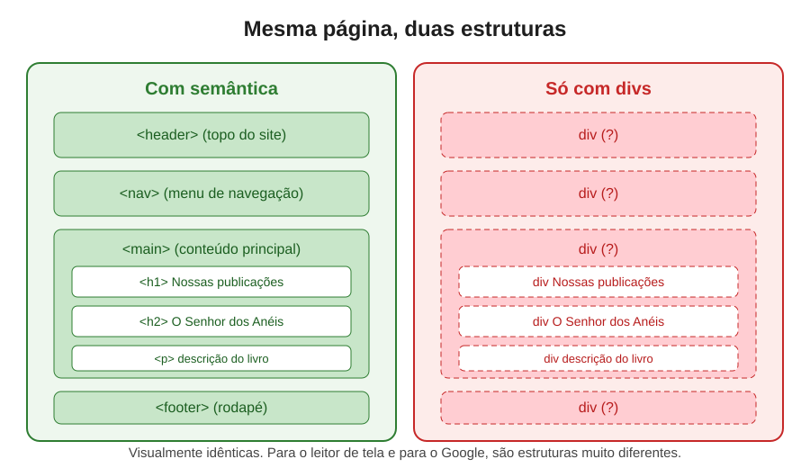
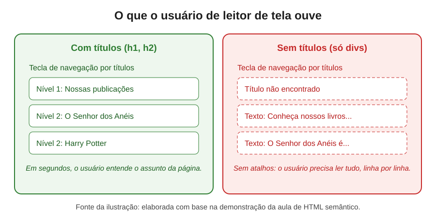
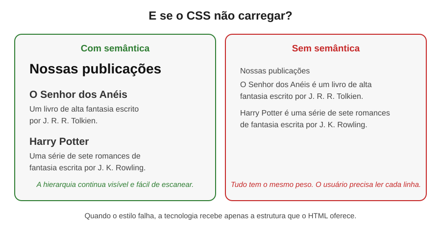

# Semântica e Acessibilidade na Web Moderna

> Uma documentação sobre por que o HTML deve dizer **o que** o conteúdo é, e não apenas **como** ele deve parecer, e como isso muda a vida de milhões de pessoas.



---

## Índice

- [Introdução: uma conversa sobre pessoas](#introdução-uma-conversa-sobre-pessoas)
- [Parte 1: o que é semântica no HTML](#parte-1-o-que-é-semântica-no-html)
- [Parte 2: o que é acessibilidade e por que ela importa](#parte-2-o-que-é-acessibilidade-e-por-que-ela-importa)
- [Parte 3: os três motivos para usar semântica](#parte-3-os-três-motivos-para-usar-semântica)
- [Parte 4: um experimento com leitor de tela](#parte-4-um-experimento-com-leitor-de-tela)
  - [4.1 Navegação por títulos (headings)](#41-navegação-por-títulos-headings)
  - [4.2 O que acontece quando o título desaparece](#42-o-que-acontece-quando-o-título-desaparece)
  - [4.3 Listas que contam a história](#43-listas-que-contam-a-história)
- [Parte 5: quando o CSS não carrega](#parte-5-quando-o-css-não-carrega)
- [Parte 6: o modo leitura e o conteúdo limpo](#parte-6-o-modo-leitura-e-o-conteúdo-limpo)
- [Parte 7: comparação lado a lado](#parte-7-comparação-lado-a-lado)
- [Parte 8: erros comuns que você precisa evitar](#parte-8-erros-comuns-que-você-precisa-evitar)
- [Parte 9: semântica e Google (SEO)](#parte-9-semântica-e-google-seo)
- [Parte 10: como testar você mesmo](#parte-10-como-testar-você-mesmo)
- [Parte 11: a acessibilidade é responsabilidade de quem?](#parte-11-a-acessibilidade-é-responsabilidade-de-quem)
- [Glossário de termos técnicos](#glossário-de-termos-técnicos)
- [Referências e créditos](#referências-e-créditos)
- [Imagens desta documentação](#imagens-desta-documentação)

---

## Introdução: uma conversa sobre pessoas

Quando a gente começa a programar, a tela é o nosso mundo. Abrimos o navegador, ajustamos uma cor, uma fonte, um espaçamento, e o resultado parece suficiente. Se a página fica bonita no nosso monitor, a sensação é de missão cumprida.

Mas existe uma pergunta que quase nunca fazemos: **e se a pessoa do outro lado não enxergar essa tela?**

Ela pode usar um leitor de tela, um programa que lê o conteúdo em voz alta. Pode navegar só pelo teclado, sem mouse. Pode ter baixa visão e ampliar a página em 400%. Pode ter dificuldades cognitivas e precisar de uma estrutura clara para entender o que está lendo. Pode estar com uma conexão lenta, com o CSS que não carregou, ou em um celular velho com uma tela pequena.

A boa notícia é que a web foi projetada, desde o início, para funcionar para todo mundo. A má notícia é que muitos sites são construídos de um jeito que quebra essa promessa, muitas vezes sem que o desenvolvedor perceba.

Esta documentação nasce de uma aula em que o instrutor, André, mostra na prática, com um leitor de tela real, como um mesmo conteúdo muda completamente de tamanho e de clareza quando a estrutura HTML é bem feita ou mal feita. Ao longo do texto, vamos ver essa experiência, entender os conceitos por trás dela, conferir o que dizem as diretrizes oficiais e pensar em como aplicar isso no nosso dia a dia.

> **Uma nota de empatia:** a acessibilidade não é um favor que fazemos a um grupo pequeno. Ela é uma forma de respeitar as diferentes maneiras como as pessoas vivem e usam a internet. Todos nós, em algum momento, vamos estar em uma situação que limita a nossa visão, a nossa audição, a nossa mobilidade ou a nossa atenção. Acessibilidade é, no fundo, cuidado com a pessoa que ainda não conhecemos.

---

## Parte 1: o que é semântica no HTML

### A definição

**Semântica** é o estudo do significado. Quando aplicamos esse conceito ao HTML, falamos de **semântica HTML**: escolher a tag que descreve o **papel** do conteúdo, e não apenas a aparência que ele deve ter.

Veja a diferença:

```html
<!-- Sem semântica: sabemos que existe um texto, mas não o que ele é -->
<div class="titulo-grande">Nossas publicações</div>
<div class="subtitulo">O Senhor dos Anéis</div>
<div class="texto">Um livro de alta fantasia escrito por J. R. R. Tolkien.</div>

<!-- Com semântica: o próprio código informa a função de cada parte -->
<h1>Nossas publicações</h1>
<h2>O Senhor dos Anéis</h2>
<p>Um livro de alta fantasia escrito por J. R. R. Tolkien.</p>
```

Visualmente, os dois blocos podem ser idênticos. A diferença está no **significado** que o navegador, o leitor de tela e o Google recebem.

### Por que uma `div` não é ruim

A tag `div` é um contêiner genérico. Ela não tem significado próprio, e isso é intencional. Ela existe para agrupar conteúdo e aplicar estilos. Usá-la é normal e necessário.

O problema não é a `div`. O problema é usá-la **no lugar de uma tag que tem significado**, como um título, um parágrafo ou um botão. Quando isso acontece, a informação sobre o papel do conteúdo se perde.

Um jeito simples de pensar: `div` é como uma caixa de papelão sem etiqueta. Serve para guardar coisas, mas ninguém sabe o que tem dentro sem abrir. Uma tag semântica é como uma caixa com a etiqueta "Livros de fantasia". Quem passa por ela entende na hora.

### Tags semânticas mais importantes

| Tag | Função | Quando usar |
|---|---|---|
| `<header>` | Cabeçalho de uma seção ou da página | Logo, título principal e menu do topo |
| `<nav>` | Bloco de navegação | Menus e links de navegação principais |
| `<main>` | Conteúdo principal da página | Envolve o conteúdo exclusivo da página, sem menus e rodapés |
| `<article>` | Conteúdo independente | Uma notícia, um post de blog, um card que faz sentido sozinho |
| `<section>` | Agrupamento temático | Uma parte da página com um assunto próprio, geralmente com título |
| `<aside>` | Conteúdo relacionado, mas secundário | Barra lateral, notas, links relacionados |
| `<footer>` | Rodapé | Informações de contato, direitos autorais, links finais |
| `<h1>` a `<h6>` | Títulos e subtítulos | Organização hierárquica do conteúdo |
| `<p>` | Parágrafo | Blocos de texto |
| `<ul>`, `<ol>`, `<li>` | Listas | Conjuntos de itens relacionados |
| `<button>` | Botão | Ações que a pessoa executa na página |
| `<a>` | Link | Navegação entre páginas ou seções |

---

## Parte 2: o que é acessibilidade e por que ela importa

### A definição

**Acessibilidade web** é a prática de criar sites e aplicações que podem ser usados por pessoas com diferentes capacidades e limitações. O W3C, organização que cria os padrões da web, define a acessibilidade como a possibilidade de que as pessoas com deficiência possam perceber, entender, navegar e interagir com a web, além de contribuir com ela.

Na prática, acessibilidade inclui pessoas:

- **com deficiência visual**, total ou parcial, que podem usar leitores de tela ou ampliadores;
- **com deficiência auditiva**, que precisam de legendas e de textos alternativos para áudios e vídeos;
- **com deficiência motora**, que podem navegar apenas pelo teclado ou por tecnologias assistivas;
- **com deficiências cognitivas, de linguagem ou de aprendizagem**, que se beneficiam de estrutura clara e linguagem simples;
- **com limitações temporárias**, como um braço engessado, uma dor de cabeça forte ou um celular com a bateria quase no fim;
- **com limitações situacionais**, como estar no sol forte, em um ambiente barulhento ou com uma só mão livre.

Esse último ponto é importante: a acessibilidade beneficia todo mundo. Uma legenda ajuda quem está em um transporte público sem fone. Um contraste bom ajuda quem está ao ar livre. Uma estrutura clara ajuda quem está com pressa.

### Os números

Segundo a Organização Mundial da Saúde (OMS), em seu material sobre deficiência, cerca de **1,3 bilhão de pessoas**, o que representa aproximadamente **16% da população mundial**, vivem com alguma forma de deficiência significativa. No Brasil, o Censo Demográfico de 2010 do IBGE identificou cerca de **45 milhões de pessoas** com algum tipo de deficiência, o equivalente a quase um quarto da população naquele ano.

Esses números fazem uma conta simples e poderosa: se você desenvolve um site para qualquer público, é muito provável que uma parcela significativa dele tenha alguma dessas necessidades. Ignorar a acessibilidade não é uma escolha neutra. É uma decisão de deixar essas pessoas do lado de fora.

### A base legal no Brasil

No Brasil, a **Lei Brasileira de Inclusão da Pessoa com Deficiência** (Lei nº 13.146/2015, também chamada de Estatuto da Pessoa com Deficiência) estabelece a acessibilidade como direito, incluindo o acesso à informação e à comunicação, o que engloba os meios digitais. O **Modelo de Acessibilidade em Governo Eletrônico (eMAG)**, mantido pelo Governo Federal, traz recomendações específicas para sites públicos brasileiros.

### Os padrões internacionais

As **WCAG** (*Web Content Accessibility Guidelines*, ou Diretrizes de Acessibilidade para Conteúdo Web) são o principal conjunto de diretrizes internacionais, publicado pelo W3C. Elas se baseiam em quatro princípios, conhecidos pela sigla **POUR**:

- **Perceptível:** as informações precisam ser apresentadas de forma que a pessoa consiga percebê-las, por exemplo com textos alternativos para imagens.
- **Operável:** a interface precisa funcionar com teclado, sem armadilhas e com tempo suficiente para ler.
- **Compreensível:** o conteúdo e a navegação precisam ser claros e previsíveis.
- **Robusto:** o conteúdo precisa funcionar bem com diferentes navegadores e tecnologias assistivas, presentes e futuras.

A semântica HTML é uma das bases que sustentam esses quatro princípios. Sem ela, é muito mais difícil cumprir qualquer um deles.

---

## Parte 3: os três motivos para usar semântica

A aula apresenta três motivos principais para marcar o conteúdo de forma semântica. Vamos explorar cada um.

### Motivo 1: acessibilidade

Leitores de tela e outras tecnologias assistivas usam a estrutura do HTML para construir uma representação do site. Essa representação é chamada de **árvore de acessibilidade** (*accessibility tree*): uma versão simplificada da página que o sistema operacional entrega para a tecnologia assistiva.

Quando a estrutura é semântica, a árvore traz informações úteis, como "este é um título de nível 2", "esta é uma lista com cinco itens" ou "esta é a navegação principal". Quando a estrutura é só de `div`, a árvore vem vazia de significado, e a tecnologia só consegue ler textos soltos.

É por isso que a semântica não é uma questão estética. Ela muda o que a tecnologia consegue entregar para a pessoa.

### Motivo 2: os navegadores e seus recursos extras

Os navegadores também usam a semântica. Alguns exemplos:

- o **modo leitura** do Safari, do Firefox e de outros navegadores identifica o conteúdo principal para exibi-lo sem anúncios e distrações;
- a **tradução automática** funciona melhor quando o navegador entende quais partes são títulos e quais são parágrafos;
- o **recurso de ir para o conteúdo** e os **atalhos de teclado** dependem de pontos de referência bem definidos;
- as **ferramentas de impressão e de exportação** conseguem organizar melhor o documento;
- o **zoom de texto** e o **ajuste de fonte** mantêm a hierarquia visual e lógica do conteúdo.

Os navegadores são, afinal, os intermediários entre o nosso código e a pessoa que usa o site. Quanto mais informação útil eles recebem, melhor conseguem ajudar.

### Motivo 3: indexadores e máquinas

O terceiro motivo é técnico e estratégico. Os **indexadores** são programas, como o robô do Google, que leem o código das páginas para entender do que elas tratam e decidir onde mostrá-las nos resultados de busca.

Esses robôs são, em certo sentido, leitores sem olhos. Eles não veem cores nem layouts. Eles leem a estrutura. Um site com títulos claros, parágrafos bem marcados e um `<main>` identificado é muito mais fácil de entender e de classificar do que um site feito só com `div`.

Veremos esse ponto em detalhe na Parte 9.

---

## Parte 4: um experimento com leitor de tela

A aula inteira gira em torno de um experimento simples. O instrutor cria uma página com um título principal, dois subtítulos e dois parágrafos. Primeiro, ele usa tags semânticas. Depois, substitui todas por `div`, mantendo exatamente o mesmo CSS. Visualmente, nada muda. Mas a experiência com o leitor de tela muda completamente.

Vamos entender o que acontece em cada etapa.

### 4.1 Navegação por títulos (headings)

Uma das funções mais importantes de um leitor de tela é permitir que a pessoa **navegue pelo conteúdo sem ler tudo de ponta a ponta**. A forma mais comum de fazer isso é pulando de título em título.

Com a página marcada semanticamente, o leitor de tela consegue:

1. ir direto para o título principal, `<h1>`, que anuncia "Nossas publicações";
2. pular para o próximo título de nível 2, `<h2>`, que anuncia "O Senhor dos Anéis";
3. pular para o outro `<h2>`, "Harry Potter".

Em poucos segundos, a pessoa entende o assunto da página: publicações de livros de fantasia. Se quiser saber mais sobre um dos títulos, ela lê o parágrafo abaixo, sem precisar passar pelo restante.



### Por que os títulos importam tanto

Os títulos funcionam como um **índice automático** da página. Eles mostram a estrutura do conteúdo sem exigir leitura completa. Uma pessoa que enxerga consegue fazer isso com os olhos, escaneando títulos e subtítulos. Uma pessoa que usa leitor de tela precisa de um equivalente, e esse equivalente são os próprios títulos marcados no HTML.

A aula cita uma pesquisa da **WebAIM** (organização que pesquisa acessibilidade na web), a *Screen Reader User Survey*, que coleta respostas de pessoas que usam leitores de tela. Na edição apresentada na aula, uma parcela alta dos respondentes disse que os títulos são muito importantes para a navegação, e uma grande maioria afirmou usá-los com frequência. Os detalhes da pesquisa estão na seção de referências, e vale a pena ler o relatório completo na fonte.

### Como os títulos devem ser organizados

Três regras básicas:

1. **Use apenas um `<h1>` por página**, que representa o assunto principal.
2. **Respeite a hierarquia**: depois de um `<h1>`, use `<h2>`; depois de um `<h2>`, use `<h3>`, e assim por diante.
3. **Não pule níveis só por causa do tamanho da fonte**. O tamanho é controlado pelo CSS. A tag define o significado.

Esse último ponto é um dos erros mais comuns. Muita gente escolhe `<h4>` porque o texto precisa ser pequeno, ou `<h1>` porque quer um texto grande. O resultado é uma estrutura confusa para quem depende da semântica. Use o CSS para ajustar a aparência e o HTML para definir o papel.

```html
<!-- Errado: a tag foi escolhida pelo tamanho visual -->
<h4>Nossas publicações</h4>

<!-- Certo: a tag reflete o papel, e o CSS cuida do tamanho -->
<h1 class="titulo-pagina">Nossas publicações</h1>
```

```css
.titulo-pagina {
  font-size: 1.5rem; /* o tamanho é responsabilidade do CSS */
}
```

### 4.2 O que acontece quando o título desaparece

Agora vem a parte mais reveladora do experimento. O instrutor troca todos os títulos e parágrafos por `div`, salva e recarrega a página. Visualmente, tudo continua igual. Mas, ao ativar o leitor de tela e tentar ir para o título, a resposta é: **título não encontrado**.

A página inteira fica sem nenhum ponto de referência. A única forma de navegar agora é avançar texto por texto, como se fosse um livro sem capítulos e sem sumário, em que é preciso ler cada página para descobrir onde o próximo capítulo começa.

O instrutor observa que, a partir desse ponto, o site já ficou muito mais difícil para quem usa leitor de tela. Na prática, muitas pessoas simplesmente fechariam a página e não voltariam. E isso aconteceu porque **nenhuma tag foi removida e nenhum conteúdo foi perdido**. Só o significado sumiu.

Pense num exemplo do cotidiano: imagine entrar em um portal de notícias e precisar ler o título e o subtítulo de cada matéria para descobrir o que está disponível. Seria exaustivo, e ninguém faria isso. Para uma pessoa com deficiência visual, muitas vezes essa é a única realidade possível.

### 4.3 Listas que contam a história

Outro exemplo da aula é a **lista**. Quando um conjunto de itens é marcado com `<ul>` ou `<ol>`, o leitor de tela anuncia algo como "lista com cinco itens" e depois lê cada item, um por um. Com essa informação, a pessoa sabe quantos elementos vai encontrar e onde eles começam e terminam.

Quando a lista é feita só com `div`, o leitor simplesmente lê uma sequência de textos. A pessoa não sabe que aquilo é um conjunto, não sabe quantos itens existem e não consegue pular para o final da lista.

```html
<!-- Com semântica: o leitor anuncia "lista com 3 itens" -->
<ul>
  <li>Senhor dos Anéis</li>
  <li>Harry Potter</li>
  <li>Crônicas de Nárnia</li>
</ul>

<!-- Sem semântica: o leitor lê três textos soltos -->
<div>Senhor dos Anéis</div>
<div>Harry Potter</div>
<div>Crônicas de Nárnia</div>
```

Esse detalhe parece pequeno, mas ele é a diferença entre entender um catálogo e tentar adivinhar onde ele termina.

---

## Parte 5: quando o CSS não carrega

Agora vem um cenário que muitos desenvolvedores nunca consideram: **o CSS pode não carregar**.

Isso acontece por vários motivos. A internet pode cair por um instante. Um arquivo pode estar com o caminho errado. Um bloqueador pode impedir o carregamento. Um servidor pode estar lento. O navegador carrega o HTML primeiro, porque ele é a base da página, e só depois tenta buscar o CSS. Se essa etapa falha, o usuário vê a página "crua".

Veja a comparação:

- **Com semântica**, sem CSS: a página continua legível. Os títulos aparecem maiores, os parágrafos têm espaçamento natural e a hierarquia continua clara. A pessoa consegue escanear o conteúdo sem dificuldade.
- **Sem semântica**, sem CSS: tudo vira uma sequência de textos do mesmo tamanho, sem espaçamento e sem distinção. A pessoa precisa ler cada linha para descobrir do que a página trata.



Esse cenário mostra que a semântica funciona como uma **rede de segurança**. Ela não depende do estilo para existir. Quando o estilo falha, a estrutura ainda sustenta a página.

Isso também ajuda pessoas em conexões lentas, em dispositivos antigos e em navegadores que não suportam certas propriedades de CSS. Ou seja, a semântica não serve só para quem usa tecnologia assistiva. Ela serve para qualquer pessoa em uma situação menos ideal.

---

## Parte 6: o modo leitura e o conteúdo limpo

O **modo leitura** é um recurso presente em navegadores como o Safari, e também em outros navegadores e extensões. Quando ativado, ele tenta identificar o **conteúdo principal** da página e remove o que não é essencial: anúncios, menus, barras laterais e sugestões de outras matérias.

Para fazer isso, o navegador precisa **identificar** o que é o conteúdo principal. E ele faz essa identificação lendo a semântica da página.

Na aula, o instrutor demonstra duas situações:

1. **Página com conteúdo marcado semanticamente**: o modo leitura consegue extrair o texto, os títulos, a imagem e a legenda com estilo adequado. O resultado é limpo e fácil de escanear.
2. **Página com o mesmo conteúdo, mas envolvido apenas por `div`**: o modo leitura não sabe o que é principal. O resultado mantém tudo misturado, sem hierarquia, e a pessoa perde a capacidade de escanear.

Um detalhe importante da aula é o uso da tag `<main>`. Ela marca o **conteúdo principal** da página. Sem ela, o navegador precisa adivinhar onde o conteúdo começa e termina. Com ela, a informação é explícita.

```html
<body>
  <header>
    <nav>
      <!-- links do menu -->
    </nav>
  </header>

  <main>
    <h1>Nossas publicações</h1>
    <article>
      <h2>O Senhor dos Anéis</h2>
      <p>Um livro de alta fantasia escrito por J. R. R. Tolkien.</p>
    </article>
  </main>

  <footer>
    <p>Informações de contato</p>
  </footer>
</body>
```

Um benefício prático: sites que usam `<main>`, `<header>`, `<nav>` e `<footer>` ficam mais fáceis de usar com modos leitura, com leitores de tela, com ferramentas de tradução e com atalhos do próprio navegador.

---

## Parte 7: comparação lado a lado

Esta é a parte que resume todo o raciocínio. A tabela abaixo mostra, de forma direta, o que muda para cada tipo de usuário e para cada tipo de tecnologia quando o site é construído com semântica ou sem ela.

| Situação | Com semântica | Sem semântica (só `div`) |
|---|---|---|
| **Leitor de tela** navega pelos títulos | Pula de título em título e entende a estrutura | Não encontra títulos e precisa ler tudo |
| **Leitor de tela** encontra uma lista | Anuncia "lista com N itens" | Lê textos soltos, sem saber que são um conjunto |
| **Navegação por teclado** | Botões e links são alcançáveis e têm função clara | Elementos clicáveis com `div` podem não receber foco |
| **CSS não carrega** | A página continua legível pela hierarquia | Vira um bloco de texto sem distinção |
| **Modo leitura** | Extrai o conteúdo principal com qualidade | Mistura conteúdo com menus e anúncios |
| **Tradução automática** | Entende títulos, parágrafos e listas | Tem mais dificuldade para separar as partes |
| **Google e outros indexadores** | Entende o assunto e a importância de cada parte | Entende menos o contexto e a hierarquia |
| **Manutenção do código** | Fácil de ler e de alterar, pois o HTML se explica | Difícil de entender, porque tudo parece igual |
| **Experiência para o usuário sem deficiência** | Visualmente igual, mas com mais robustez | Visualmente igual, mas mais frágil |

Um ponto que costuma surpreender: **a semântica quase nunca muda a aparência**. Ela muda o significado. O visual continua sob controle do CSS. Por isso, não existe motivo técnico para abrir mão dela.

---

## Parte 8: erros comuns que você precisa evitar

Aprender com erros é um dos caminhos mais rápidos para dominar um assunto. Esta seção reúne os erros mais frequentes em relação à semântica e à acessibilidade, com a explicação de por que eles acontecem e como corrigi-los.

### Erro 1: usar `div` para tudo

**O que acontece:** a página vira uma sopa de `div`. Não há títulos, listas, navegação ou áreas identificadas.

**Por que acontece:** a `div` é a tag mais conhecida e a mais fácil de usar. Muitos desenvolvedores a usam por hábito, sem pensar no significado.

**Como corrigir:** antes de criar uma `div`, pergunte-se: existe uma tag que descreve melhor o papel deste conteúdo? Se sim, use-a.

### Erro 2: escolher títulos pelo tamanho da fonte

**O que acontece:** o `<h3>` aparece como texto pequeno, o `<h1>` aparece gigante, e a hierarquia se perde.

**Por que acontece:** a tag é tratada como um atalho visual.

**Como corrigir:** escolha a tag pelo papel (título principal, seção, subseção) e ajuste o tamanho com CSS.

### Erro 3: pular níveis de título

**O que acontece:** a página vai de `<h1>` direto para `<h4>`, e a estrutura fica sem lógica.

**Por que acontece:** o desenvolvedor escolhe um nível pelo visual, e não pela ordem do conteúdo.

**Como corrigir:** mantenha a sequência lógica (`h1`, `h2`, `h3`) e, se precisar de outro visual, use CSS.

### Erro 4: elemento clicável feito com `div`

```html
<!-- Errado: parece um botão, mas não é -->
<div class="botao" onclick="comprar()">Comprar</div>

<!-- Certo: é um botão, e o navegador já cuida do teclado e do leitor de tela -->
<button type="button" onclick="comprar()">Comprar</button>
```

**O que acontece:** a `div` não recebe foco pelo teclado, não é anunciada como botão e não responde à tecla Enter ou Espaço, a não ser que o desenvolvedor programe tudo isso manualmente.

**Por que acontece:** é mais fácil estilizar uma `div` do que um botão, e o comportamento padrão do botão nem sempre é conhecido.

**Como corrigir:** use `<button>` para ações e `<a href="...">` para navegação. As tags nativas já vêm com foco, teclado e anúncio prontos.

### Erro 5: imagens sem texto alternativo

```html
<!-- Errado: o leitor de tela não sabe o que a imagem mostra -->


<!-- Certo: o texto alternativo descreve a imagem -->


<!-- Certo também: imagem decorativa, sem informação útil -->

```

**O que acontece:** a pessoa que usa leitor de tela não sabe o que existe na imagem, ou ouve o nome do arquivo, como "img_0293.jpg", o que não ajuda em nada.

**Como corrigir:** sempre use o atributo `alt`. Se a imagem é apenas decorativa, deixe o `alt` vazio, para que o leitor de tela a ignore.

### Erro 6: links com texto genérico

```html
<!-- Errado: "clique aqui" não diz para onde o link leva -->
<a href="/publicacoes">Clique aqui</a>

<!-- Certo: o texto descreve o destino -->
<a href="/publicacoes">Ver todas as publicações</a>
```

**O que acontece:** leitores de tela permitem listar todos os links da página. Se todos dizem "clique aqui", a lista não serve para nada.

**Como corrigir:** escreva o texto do link de forma que faça sentido mesmo fora do contexto.

### Erro 7: formulários sem rótulo

```html
<!-- Errado: o campo não tem nome para o leitor de tela -->
<input type="text" placeholder="Seu e-mail">

<!-- Certo: o label associa o texto ao campo -->
<label for="email">Seu e-mail</label>
<input type="email" id="email" name="email">
```

**O que acontece:** o `placeholder` some quando a pessoa começa a digitar, e muitos leitores de tela não o tratam como rótulo. A pessoa não sabe o que deve preencher.

**Como corrigir:** use sempre `<label>` associado ao campo com `for` e `id`.

### Erro 8: confiar só na cor para transmitir informação

**O que acontece:** campos obrigatórios aparecem só em vermelho, ou um status é indicado apenas por uma bolinha colorida. Uma pessoa daltônica, ou que está lendo em uma tela sem cor, não percebe a informação.

**Como corrigir:** combine cor com texto, ícone ou outro sinal visual. Por exemplo, "campo obrigatório" escrito ao lado do campo.

### Erro 9: esquecer que o teclado também navega

**O que acontece:** o site funciona bem com mouse, mas não é possível chegar a alguns botões usando a tecla Tab, ou o foco some na tela.

**Como corrigir:** teste o site navegando só com o teclado. Use Tab para avançar, Shift + Tab para voltar e Enter ou Espaço para ativar. Não remova o indicador de foco (`outline`) sem colocar outro no lugar.

### Erro 10: achar que "funciona no meu computador" basta

**O que acontece:** o site parece perfeito para quem desenvolve, mas falha para pessoas que usam tecnologias diferentes.

**Como corrigir:** teste com pelo menos um leitor de tela, navegue só pelo teclado, aumente o zoom, verifique o contraste de cores e, sempre que possível, convide pessoas com deficiência para testar.

---

## Parte 9: semântica e Google (SEO)

**SEO** (*Search Engine Optimization*, ou otimização para mecanismos de busca) é o conjunto de práticas que ajudam um site a ser encontrado no Google e em outros buscadores. Uma parte importante dessas práticas depende da estrutura do HTML.

O Google documenta que seus sistemas usam os títulos e a estrutura da página para entender o conteúdo. Entre as recomendações oficiais da Central de Pesquisa do Google (Google Search Central), estão:

- usar um título claro e descritivo na página;
- organizar o conteúdo com títulos que reflitam a hierarquia;
- usar textos alternativos descritivos em imagens;
- criar links com texto que explique o destino.

Note que essas recomendações coincidem quase totalmente com as de acessibilidade. Isso não é coincidência. Um conteúdo bem estruturado é melhor para máquinas e para pessoas ao mesmo tempo.

Vale um cuidado: semântica não é um truque para "enganar" o Google. Ela não garante posição no topo dos resultados. Ela garante que o conteúdo seja **compreendido corretamente**, o que é a base de qualquer boa estratégia de busca.

### Um exemplo de estrutura favorável ao SEO

```html
<main>
  <article>
    <h1>Guia de semântica HTML</h1>
    <p>Neste guia, você vai entender por que a estrutura do HTML importa.</p>

    <section>
      <h2>O que é semântica</h2>
      <p>Semântica é a escolha de tags que descrevem o papel do conteúdo.</p>
    </section>

    <section>
      <h2>Por que ela importa</h2>
      <p>Ela melhora a acessibilidade, a compreensão pelos navegadores e a leitura pelos buscadores.</p>
    </section>
  </article>
</main>
```

Esse exemplo é simples, mas comunica tudo: qual é o assunto principal, quais são as seções, qual parte é o conteúdo e como cada parte se relaciona com as outras.

---

## Parte 10: como testar você mesmo

Você não precisa ser especialista para começar a testar acessibilidade. Algumas ferramentas gratuitas já ajudam bastante.

### Testes manuais (os mais importantes)

**1. Navegue só com o teclado.** Pressione Tab e observe se o foco aparece em todos os elementos interativos, na ordem lógica. Se algo for alcançável só com o mouse, há um problema.

**2. Use um leitor de tela.** Cada sistema tem o seu:

- **VoiceOver**, no Mac e no iPhone, já vem instalado. No Mac, pode ser ativado com Command + F5. A navegação por títulos costuma usar a combinação Control + Option + Command + H.
- **NVDA**, gratuito e de código aberto para Windows, muito usado no Brasil. A tecla H pula para o próximo título quando o modo de navegação está ativo.
- **TalkBack**, no Android, e o leitor de tela do iOS.

Não se preocupe em dominar tudo de uma vez. Faça o que o instrutor fez na aula: ative o leitor, entre na página, navegue por títulos e tente ler uma lista. Só isso já muda a sua percepção.

**3. Aumente o zoom.** Teste em 200% ou mais e veja se o conteúdo continua legível, sem cortes ou sobreposições.

**4. Desative o CSS.** Em muitos navegadores há uma opção para isso no menu de desenvolvedor. Veja se a página ainda faz sentido.

### Ferramentas automáticas

- **Ferramentas de desenvolvedor do navegador**: a aba de acessibilidade mostra a árvore de acessibilidade, que é exatamente o que a tecnologia assistiva recebe.
- **Lighthouse**, integrado ao Chrome DevTools: gera uma pontuação de acessibilidade e aponta problemas comuns.
- **axe DevTools**: extensão que encontra violações de acessibilidade em uma página.
- **WAVE**, da WebAIM: mostra visualmente erros e alertas diretamente na página.

Importante: ferramentas automáticas encontram apenas uma parte dos problemas. Normalmente, elas identificam algo entre um terço e a metade das questões. O resto depende de julgamento humano e de testes reais.

---

## Parte 11: a acessibilidade é responsabilidade de quem?

Uma resposta curta: de todos. Mas vale detalhar.

**Desenvolvedores** escrevem o HTML, o CSS e o JavaScript. Eles decidem se a estrutura vai carregar significado.

**Designers** definem contraste, tamanhos, espaçamentos e a ordem visual dos elementos. Uma interface bonita, mas com contraste fraco, exclui pessoas.

**Redatores e equipes de conteúdo** escrevem títulos claros, textos alternativos e links com descrições úteis.

**Gestores e empresas** precisam entender que acessibilidade não é um item de última hora. Ela deve estar no planejamento desde o início, porque corrigir depois custa mais.

**Usuários** são a fonte mais valiosa de aprendizado. Quando possível, a melhor forma de melhorar um site é ouvir as pessoas que o usam com tecnologias assistivas.

Existe um princípio que resume bem essa responsabilidade: é mais fácil construir acessível desde o início do que remendar depois. Um HTML semântico custa, na prática, quase o mesmo tempo que um HTML sem semântica. A diferença está na atenção.

---

## Glossário de termos técnicos

**Acessibilidade (a11y):** conjunto de práticas que permitem que pessoas com diferentes capacidades usem a web. A sigla "a11y" vem de "accessibility", em que o número 11 representa as letras omitidas entre o "a" e o "y".

**Árvore de acessibilidade (accessibility tree):** representação simplificada da página, criada pelo navegador, que as tecnologias assistivas usam para entender o conteúdo.

**Atributo `alt`:** texto alternativo de uma imagem, que descreve seu conteúdo para quem não pode vê-la.

**Foco:** indicação do elemento que está selecionado no momento, por exemplo quando a tecla Tab é pressionada. Ele é essencial para quem navega pelo teclado.

**Heading (cabeçalho ou título):** elemento de título, de `<h1>` a `<h6>`, que organiza a hierarquia do conteúdo.

**Indexador:** programa que lê páginas da web para catalogá-las em buscadores, como o robô do Google.

**Landmark (ponto de referência):** região identificada do documento, como `<header>`, `<nav>`, `<main>` e `<footer>`, que permite pular rapidamente entre áreas da página.

**Leitor de tela (screen reader):** tecnologia assistiva que lê o conteúdo da tela em voz alta ou em braille.

**Modo leitura (reader mode):** recurso do navegador que exibe apenas o conteúdo principal de uma página.

**Semântica HTML:** uso de tags que descrevem o significado e a função do conteúdo.

**SEO (Search Engine Optimization):** práticas para melhorar a compreensão e a visibilidade de um site nos buscadores.

**Tecnologia assistiva:** qualquer recurso, software ou hardware que ajuda uma pessoa com deficiência a usar a tecnologia, como leitores de tela, ampliadores, teclados alternativos e comandos por voz.

**WCAG:** Web Content Accessibility Guidelines, ou Diretrizes de Acessibilidade para Conteúdo Web, publicadas pelo W3C.

**W3C (World Wide Web Consortium):** organização internacional que cria padrões abertos para a web, incluindo HTML, CSS e acessibilidade.

---

## Referências e créditos

As informações desta documentação foram elaboradas com base em fontes oficiais e confiáveis. Os conteúdos foram parafraseados, e não copiados literalmente. Sempre que possível, consulte as fontes originais para aprofundamento.

### Fonte principal: a aula

- **Aula de HTML semântico e acessibilidade**, ministrada pelo instrutor André. A transcrição usada como base descreve a demonstração com o leitor de tela VoiceOver, a navegação por títulos, a experiência com o CSS desativado e o modo leitura do Safari. Todas as ideias da aula foram reorganizadas e ampliadas nesta documentação.

### Sites fornecidos como referência

- **WebAIM – Screen Reader User Survey #9**, da equipe da WebAIM (organização vinculada à Utah State University, nos Estados Unidos). Pesquisa com usuários de leitores de tela sobre seus hábitos de navegação e uso de títulos. Disponível em: https://webaim.org/projects/screenreadersurvey9/

- **Tink.uk**, blog pessoal de **Léonie Watson**, desenvolvedora front-end com deficiência visual total, reconhecida internacionalmente por seu trabalho em acessibilidade e HTML semântico. Léonie também participou de grupos de trabalho do W3C sobre acessibilidade. Disponível em: https://tink.uk/

### Documentações oficiais

- **W3C – Web Accessibility Initiative (WAI)**, iniciativa do W3C dedicada à acessibilidade. Introdução à acessibilidade web: https://www.w3.org/WAI/fundamentals/accessibility-intro/

- **W3C – Web Content Accessibility Guidelines (WCAG) 2.2**, editada pelo grupo de trabalho do W3C. Define os critérios técnicos de acessibilidade, incluindo os princípios POUR: https://www.w3.org/TR/WCAG22/

- **W3C – WAI Page Structure Tutorial**, tutorial sobre estrutura de páginas, títulos e pontos de referência: https://www.w3.org/WAI/tutorials/page-structure/

- **WHATWG – HTML Living Standard**, especificação viva do HTML, mantida pelo WHATWG, grupo que define o padrão atual do HTML: https://html.spec.whatwg.org/

- **MDN Web Docs – Accessibility**, documentação da Mozilla, com contribuições de sua comunidade: https://developer.mozilla.org/pt-BR/docs/Web/Accessibility

- **MDN Web Docs – Elementos HTML**, referência de cada tag e de seu significado: https://developer.mozilla.org/pt-BR/docs/Web/HTML/Element

- **web.dev – Learn Accessibility**, curso gratuito do Google para aprender acessibilidade: https://web.dev/learn/accessibility

- **Google Search Central – Guia para iniciantes em SEO**, documentação oficial do Google sobre como os buscadores entendem sites: https://developers.google.com/search/docs/fundamentals/seo-starter-guide

- **Brasil – Lei nº 13.146/2015 (Lei Brasileira de Inclusão da Pessoa com Deficiência)**, publicada no Diário Oficial da União. Disponível em: https://www.planalto.gov.br/ccivil_03/_ato2015-2018/2015/lei/l13146.htm

- **Governo Federal do Brasil – Modelo de Acessibilidade em Governo Eletrônico (eMAG)**, guia brasileiro de acessibilidade para sites públicos, mantido pelo Governo Federal.

- **Organização Mundial da Saúde (OMS) – Deficiência**, fact sheet sobre deficiência e números globais: https://www.who.int/news-room/fact-sheets/detail/disability-and-health

- **IBGE – Censo Demográfico 2010**, dados sobre pessoas com deficiência no Brasil: https://www.ibge.gov.br

### Leituras e vídeos recomendados

- **Léonie Watson**, palestras e vídeos disponíveis no YouTube, em que ela demonstra o uso de leitores de tela e explica problemas comuns e soluções com HTML semântico.

- **Heydon Pickering**, autor do livro *Inclusive Components* (Smashing Magazine), com exemplos práticos de componentes acessíveis.

- **Adrian Roselli**, blog em https://adrianroselli.com, com artigos técnicos aprofundados sobre acessibilidade e leitores de tela.

- **The A11Y Project**, comunidade open source com checklists e guias práticos: https://www.a11yproject.com

---

## Imagens desta documentação

- Veja a importâncias e os problemas de se não utilizar semântica e acessibilidade.

<div style="display: flex; flex-direction: column; gap: 10px;">

  
  
  

</div>

---

**Para concluir:** o HTML é a linguagem da web, e a web é de todos. Quando escolhemos a tag certa, estamos dizendo ao mundo o que o nosso conteúdo significa. Quando cuidamos do significado, estamos cuidando das pessoas que vão ler, ouvir, navegar e encontrar aquilo que criamos. Uma boa tag semântica não é uma regra técnica chata. É uma forma de dizer: "eu pensei em você antes de você chegar".