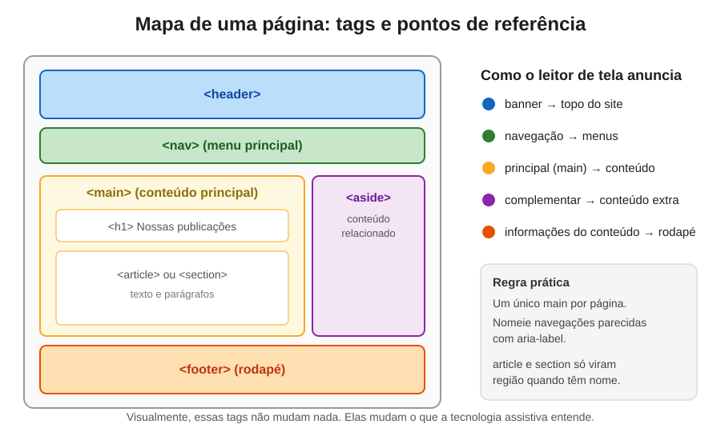
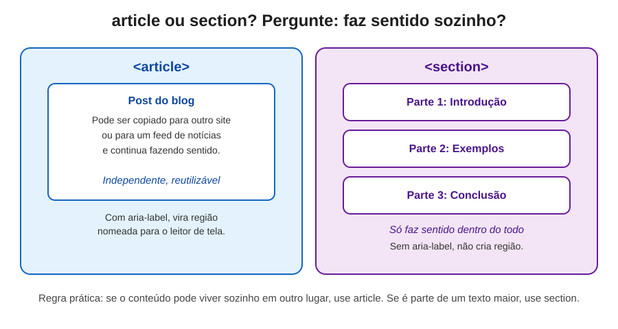
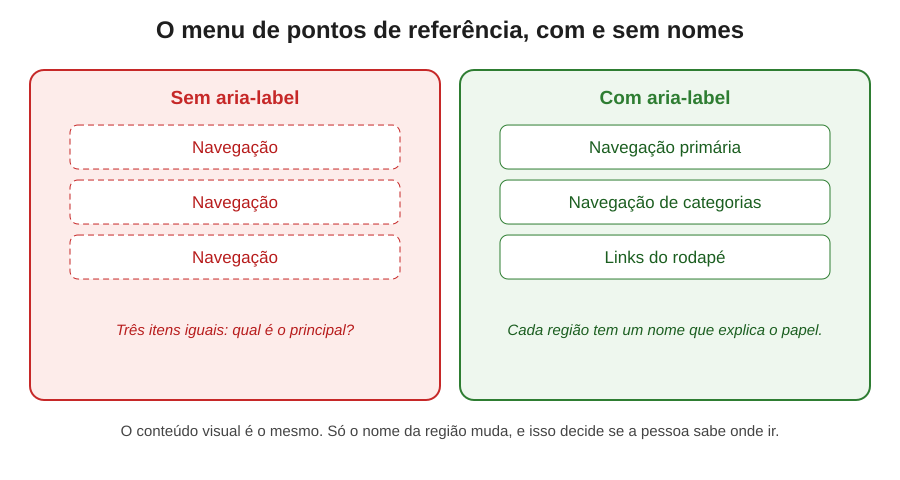

# Pontos de Referência (Landmarks): como a semântica organiza a navegação de quem não enxerga a tela

> Uma documentação sobre as tags que dividem a página em regiões claras, para que uma pessoa com deficiência visual encontre o que procura sem atravessar o site inteiro.



---

## Índice

- [Introdução: uma casa sem placas](#introdução-uma-casa-sem-placas)
- [Parte 1: o que é um ponto de referência](#parte-1-o-que-é-um-ponto-de-referência)
- [Parte 2: como o leitor de tela usa os pontos de referência](#parte-2-como-o-leitor-de-tela-usa-os-pontos-de-referência)
- [Parte 3: de `role` para tags semânticas](#parte-3-de-role-para-tags-semânticas)
- [Parte 4: as tags que criam regiões](#parte-4-as-tags-que-criam-regiões)
  - [4.1 `<main>`: o conteúdo principal](#41-main-o-conteúdo-principal)
  - [4.2 `<nav>`: a navegação](#42-nav-a-navegação)
  - [4.3 `<header>`: o cabeçalho](#43-header-o-cabeçalho)
  - [4.4 `<footer>`: o rodapé](#44-footer-o-rodapé)
  - [4.5 `<aside>`: o conteúdo extra](#45-aside-o-conteúdo-extra)
- [Parte 5: `aria-label` e `aria-labelledby`, dando nome às regiões](#parte-5-aria-label-e-aria-labelledby-dando-nome-às-regiões)
- [Parte 6: `article` ou `section`? A diferença que quase ninguém conhece](#parte-6-article-ou-section-a-diferença-que-quase-ninguém-conhece)
- [Parte 7: `header` e `footer` dentro de outras regiões](#parte-7-header-e-footer-dentro-de-outras-regiões)
- [Parte 8: um experimento: o que acontece sem pontos de referência](#parte-8-um-experimento-o-que-acontece-sem-pontos-de-referência)
- [Parte 9: comparação lado a lado](#parte-9-comparação-lado-a-lado)
- [Parte 10: pular o cabeçalho com um link de atalho](#parte-10-pular-o-cabeçalho-com-um-link-de-atalho)
- [Parte 11: erros comuns e como evitá-los](#parte-11-erros-comuns-e-como-evitá-los)
- [Parte 12: como testar você mesmo](#parte-12-como-testar-você-mesmo)
- [Parte 13: o que a especificação diz, em resumo](#parte-13-o-que-a-especificação-diz-em-resumo)
- [Glossário de termos técnicos](#glossário-de-termos-técnicos)
- [Referências e créditos](#referências-e-créditos)
- [Imagens desta documentação](#imagens-desta-documentação)

---

## Introdução: uma casa sem placas

Imagine entrar em um shopping enorme, sem placas, sem mapa e sem nenhuma indicação de andar. Você sabe que as lojas estão ali, mas para achar a farmácia precisa passar por todos os corredores, um a um, lendo cada vitrine. Agora imagine que essa é a sua rotina todos os dias, porque você não enxerga as placas que os outros enxergam.

Para uma pessoa que usa leitor de tela, uma página sem estrutura é exatamente isso. Ela ouve o conteúdo em sequência, do começo ao fim, incluindo o menu, o banner e a propaganda que aparece antes da notícia. Para chegar ao texto principal, precisa atravessar tudo isso.

Os **pontos de referência** são as placas desse shopping. Eles dizem: aqui está o menu, aqui está o conteúdo principal, aqui está o rodapé. Com elas, a pessoa escolhe por onde entrar e pula direto para o que interessa.

Esta documentação mostra, na prática com o leitor de tela VoiceOver, como essas regiões aparecem, o que acontece quando elas somem e por que um nome bem escolhido faz tanta diferença. Também incluímos um artigo de Bruce Lawson, publicado na Smashing Magazine, que esclarece a confusão mais famosa do HTML: a diferença entre `article` e `section`.

> **Uma nota de empatia:** quando uma página tem boa estrutura, quase ninguém percebe. Ela simplesmente funciona. Quando não tem, a pessoa afetada pode simplesmente desistir e ir embora, sem nem saber que o problema estava no código. Pontos de referência são pequenas decisões técnicas que decidem se alguém consegue ou não usar o que construímos.

---

## Parte 1: o que é um ponto de referência

### A definição

Um **ponto de referência** (em inglês, *landmark*) é uma **região nomeada** da página. Ele marca uma parte do conteúdo com um papel claro, como "menu de navegação", "conteúdo principal" ou "rodapé".

O termo vem da ideia de marco, aquele elemento fixo na paisagem que ajuda a se localizar. Na web, cada landmark funciona como um marco dentro da página.

### Por que o nome importa

Quando um leitor de tela entra em uma região marcada, ele anuncia o nome dela. Por exemplo: "navegação principal", "principal", "rodapé". A pessoa ouve isso e já sabe o tipo de conteúdo que virá, sem precisar lê-lo.

Esses nomes não são inventados. Eles seguem um vocabulário padrão, definido pelas especificações WAI-ARIA e HTML. Os principais são:

| Nome anunciado | Tag HTML correspondente | O que representa |
|---|---|---|
| **banner** | `<header>` (fora de outras regiões) | Topo do site, com a marca e, às vezes, a busca |
| **navegação** | `<nav>` | Bloco de links que levam a outras partes do site |
| **principal** (*main*) | `<main>` | Conteúdo central da página |
| **complementar** (*complementary*) | `<aside>` | Conteúdo relacionado, mas secundário |
| **informações do conteúdo** (*contentinfo*) | `<footer>` (fora de outras regiões) | Rodapé, com informações gerais do site |
| **região** (*region*) | `<section>` com nome | Trecho com assunto próprio, identificado por um nome |
| **formulário** (*form*) | `<form>` com nome | Bloco de campos de entrada |
| **busca** (*search*) | `<search>` ou `<form>` de busca | Área de busca do site |

Esse vocabulário é o que o leitor de tela entrega à pessoa. Se a tag está errada ou ausente, o nome também some.

---

## Parte 2: como o leitor de tela usa os pontos de referência

### O menu de pontos de referência

Leitores de tela oferecem uma forma de listar todos os pontos de referência da página de uma só vez. No VoiceOver, do Mac, isso aparece no **rotor**, um menu que a pessoa abre com um comando do teclado e navega com as setas. Em outros leitores, como o NVDA e o JAWS, há um recurso parecido, geralmente acessado por uma tecla de atalho.

Ao abrir o menu de pontos de referência de uma página bem marcada, aparecem itens como "navegação primária", "principal" e "rodapé". É como receber um sumário da página em um segundo.

### Pular entre regiões

Além do menu, muitos leitores permitem pular de uma região para a próxima com uma tecla. Assim, a pessoa pode ir direto para o conteúdo principal, sem ouvir o menu, ou pular o menu inteiro para chegar ao texto.

Esse comportamento é diferente de navegar por títulos, que vimos em outra documentação. Títulos organizam o conteúdo **dentro** de uma região. Pontos de referência organizam as **grandes regiões** da página. Os dois se complementam.

### Por que isso importa tanto

Imagine um portal de notícias sem pontos de referência. Para ler a matéria principal, a pessoa precisaria ouvir o menu, depois a barra de busca, depois as abas, depois o carrossel, depois a lista de categorias. Só então chegaria à notícia. Se ela já ouviu isso antes, quando voltar ao site, vai ter que fazer tudo de novo.

Com pontos de referência, ela pula direto para o principal. Essa economia de tempo e de paciência é a diferença entre conseguir usar o site e desistir.

---

## Parte 3: de `role` para tags semânticas

Antes do HTML5, a forma de criar uma região era usar o atributo `role`. Ele informava ao navegador e ao leitor de tela qual era a função de uma `div`:

```html
<!-- Antes do HTML5: a div precisava declarar o papel -->
<div role="navigation">
  <a href="/sobre">Sobre</a>
  <a href="/contato">Contato</a>
</div>

<div role="main">
  <h1>Nossas publicações</h1>
</div>
```

Esse método funciona, mas exige que o desenvolvedor lembre de escrever o `role` em cada bloco. Com o HTML5, as tags semânticas passaram a carregar esse papel por conta própria:

```html
<!-- Com HTML5: a própria tag informa o papel -->
<nav>
  <a href="/sobre">Sobre</a>
  <a href="/contato">Contato</a>
</nav>

<main>
  <h1>Nossas publicações</h1>
</main>
```

A regra é simples: **prefira a tag semântica**. Ela é mais legível, menos propensa a erro e já vem com o comportamento esperado pelo navegador. Só recorra ao `role` quando não existir uma tag adequada para aquela função, e, nesse caso, siga as recomendações da especificação ARIA.

Essa orientação é reforçada pelo princípio conhecido como **primeira regra do ARIA**: se existe um elemento nativo do HTML que faz o que você precisa, use-o em vez de recriar o comportamento com ARIA.

---

## Parte 4: as tags que criam regiões

Esta seção apresenta, uma a uma, as tags que criam pontos de referência. Visualmente, nenhuma delas muda a aparência da página, porque elas se comportam como `div` por padrão. A diferença está no significado que entregam.

### 4.1 `<main>`: o conteúdo principal

A tag `<main>` marca o **conteúdo principal** da página: aquilo que a pessoa veio ler ou usar. Em um blog, é o artigo. Em uma loja, é a lista de produtos. Em um painel, é o painel.

O que fica de fora do `<main>` é o que se repete em várias páginas, como menu, banner e rodapé.

```html
<body>
  <header>...</header>
  <nav>...</nav>

  <main>
    <h1>Bicicletas</h1>
    <p>Conheça nossa linha de bicicletas artesanais.</p>
  </main>

  <footer>...</footer>
</body>
```

**Regras importantes:**

- Use **um único** `<main>` visível por página. Ele representa o assunto central, e não faz sentido ter dois assuntos centrais.
- Não coloque `<main>` dentro de `<article>`, `<aside>`, `<header>`, `<footer>` ou `<nav>`.
- Ele não precisa de nome, porque é único. Por isso, o leitor de tela já o anuncia simplesmente como "principal".

**Por que o `<main>` é tão usado:** muitos usuários de leitor de tela pulam direto para ele, justamente para não ouvir a navegação inteira do site. E ferramentas como o modo leitura do navegador também usam essa marcação para identificar o que é essencial.

### 4.2 `<nav>`: a navegação

A tag `<nav>` marca um **bloco de navegação**, um conjunto de links que leva a outras partes do site. O leitor de tela a anuncia como "navegação", e a pessoa pode pular de um bloco de navegação para o outro.

```html
<nav>
  <a href="/">Início</a>
  <a href="/sobre">Sobre</a>
  <a href="/contato">Contato</a>
</nav>
```

Uma recomendação importante: use `<nav>` apenas para **blocos principais** de navegação, e não para qualquer lista de links. Um rodapé com links de política de privacidade e redes sociais pode ter sua própria `<nav>`, mas o excesso de navegações dilui o sentido da marcação.

Quando houver mais de uma `<nav>` na mesma página, veja a próxima seção. Ela explica como dar a cada uma um nome que a distinga.

### 4.3 `<header>`: o cabeçalho

A tag `<header>` marca o **cabeçalho** de uma região. Quando está no topo da página, o leitor de tela a anuncia como **banner**. Ela costuma envolver a marca do site, o menu principal e, às vezes, a busca.

```html
<header>
  <a href="/">
    
  </a>
  <nav aria-label="Principal">
    <a href="/sobre">Sobre</a>
    <a href="/contato">Contato</a>
  </nav>
</header>
```

**Por que isso é relevante:** muitas pessoas que usam leitor de tela voltam ao mesmo site com frequência. O banner, que se repete em todas as páginas, é a parte que elas menos precisam ouvir. Com a tag `<header>`, o leitor pode pular essa área com um comando, indo direto ao conteúdo.

### 4.4 `<footer>`: o rodapé

A tag `<footer>` marca o **rodapé**. No nível do site, o leitor de tela o anuncia como **informações do conteúdo** (em inglês, *contentinfo*). Ele costuma reunir informações secundárias, como direitos autorais, links para termos de uso, política de privacidade e redes sociais.

```html
<footer>
  <p>© 2026 Bikecraft. Todos os direitos reservados.</p>
  <nav aria-label="Links do rodapé">
    <a href="/termos">Termos de uso</a>
    <a href="/privacidade">Privacidade</a>
  </nav>
</footer>
```

O rodapé pode ter uma breve descrição do site, que se repete em todas as páginas, e uma lista de links com itens que não couberam na navegação principal.

### 4.5 `<aside>`: o conteúdo extra

A tag `<aside>` marca conteúdo **relacionado ao principal, mas que não é o foco**. Pense nos blocos de "posts relacionados", "mais lidos" ou "sobre o autor" que aparecem ao lado de um artigo.

```html
<main>
  <article>
    <h1>Como escolher uma bicicleta</h1>
    <p>Antes de comprar, é importante considerar o tipo de terreno...</p>
  </article>

  <aside aria-label="Leia também">
    <h2>Leia também</h2>
    <ul>
      <li><a href="/manutencao">Manutenção básica de pedal</a></li>
      <li><a href="/equipamentos">Equipamentos para pedalar à noite</a></li>
    </ul>
  </aside>
</main>
```

Na especificação, o `<aside>` cria um ponto de referência **complementar**. No VoiceOver, ele nem sempre é anunciado dessa forma, o que mostra que cada leitor pode ter comportamentos diferentes. Por isso, vale testar.

Na prática, o `<aside>` é mais comum em blogs e sites de conteúdo. Em uma loja, por exemplo, ele pode aparecer nos filtros laterais.

---

## Parte 5: `aria-label` e `aria-labelledby`, dando nome às regiões

Até aqui, as tags criam as regiões, mas quando há mais de uma do mesmo tipo, o leitor de tela precisa de um **nome** para diferenciá-las. É para isso que servem os atributos `aria-label` e `aria-labelledby`.

### Termos técnicos explicados

**ARIA** significa *Accessible Rich Internet Applications*. É um conjunto de atributos criados pelo W3C para descrever o significado e o estado de elementos para tecnologias assistivas. Todo atributo que começa com `aria-` pertence a esse conjunto.

**Nome acessível** (*accessible name*) é o texto que o leitor de tela anuncia para identificar um elemento. Ele pode vir do texto interno, de um `alt`, de um `label` ou de um atributo ARIA.

### `aria-label`: escrever o nome diretamente

O `aria-label` define o nome da região com um texto escrito no próprio atributo:

```html
<nav aria-label="Principal">
  <a href="/sobre">Sobre</a>
  <a href="/contato">Contato</a>
</nav>

<nav aria-label="Links do rodapé">
  <a href="/termos">Termos de uso</a>
  <a href="/privacidade">Privacidade</a>
</nav>
```

Agora o leitor anuncia "navegação principal" e "navegação, links do rodapé", e a pessoa sabe qual é qual.

**Uma recomendação:** não coloque nomes genéricos como "navegação" ou "menu". A tag já diz isso. O nome deve explicar **a função específica** da região.

### `aria-labelledby`: apontar para um título já existente

Às vezes, a região já tem um título visível, como um `<h2>`. Repetir o texto no `aria-label` faria o leitor dizer a mesma coisa duas vezes. Para evitar isso, use `aria-labelledby`, que aponta para o `id` do elemento que já contém o nome:

```html
<article aria-labelledby="titulo-empresa">
  <h2 id="titulo-empresa">Sobre a Bikecraft</h2>
  <p>A empresa foi fundada em 2014.</p>
</article>
```

Aqui, o leitor anuncia "Sobre a Bikecraft" uma única vez, sem repetição. O `id` precisa ser **único** na página, ou seja, não pode existir outro elemento com o mesmo valor.

**Resumo da escolha:**

- Use `aria-label` quando não houver um título visível para a região.
- Use `aria-labelledby` quando já existir um título visível, para não repetir o texto.

---

## Parte 6: `article` ou `section`? A diferença que quase ninguém conhece

Esta é uma das partes mais confusas do HTML: mesmo entre desenvolvedores experientes, é difícil encontrar quem saiba exatamente a diferença. Vamos organizar o assunto com cuidado.

### A pergunta que resolve a dúvida

Pergunte-se: **este conteúdo faz sentido se for copiado e colocado em outro lugar?**

- Se sim, use **`article`**. Ele é uma unidade independente.
- Se não, e ele é apenas uma parte de um texto maior, use **`section`**.

### Como entender a diferença na prática

Um post de blog é um bom exemplo de `article`. Se você tirar o post do site e colocar em um portal de notícias, ele continua fazendo sentido. Uma lista de produtos e uma postagem de rede social funcionam da mesma forma: são blocos completos, que podem ser reaproveitados.

Já uma `section` é uma **parte** de um artigo, como uma seção de introdução, um bloco de exemplos ou uma conclusão. Se você tirar essa parte do contexto, ela perde o sentido.

### A analogia de Bruce Lawson

No artigo da Smashing Magazine, Bruce Lawson propõe uma analogia que ajuda a fixar a ideia. Pense no `article` como uma **peça de roupa**: uma calça ou uma camisa são itens completos, que podem ser combinados com outras peças em outro look. Já a `section` é como um **trecho** de um mesmo look, que só faz sentido dentro do conjunto.

Lawson cita a especificação HTML, que descreve o `article` como uma composição **completa ou autocontida**, que pode ser distribuída ou reutilizada, por exemplo em um feed de notícias. A lista de exemplos inclui postagens de fórum, artigos de revista, comentários de usuários e widgets interativos.

### O que os leitores de tela fazem

O artigo confirma um ponto importante: **por padrão, `article` não cria um ponto de referência**. Mas, na prática, muitos leitores de tela o tratam como uma região própria, principalmente quando recebe um nome.

Já a `section` tem uma regra mais restrita. Segundo Lawson, a `section` sem nome **não cria região**. Ela só vira ponto de referência quando recebe um `aria-label` ou `aria-labelledby`. No VoiceOver, isso também pode ser confirmado: ao remover o nome, a região da `section` desaparece do menu de pontos de referência.

```html
<!-- Não cria região: sem nome, a section é só um agrupamento -->
<section>
  <h2>Introdução</h2>
  <p>...</p>
</section>

<!-- Cria região: com nome, o leitor anuncia "Resumo rápido" -->
<section aria-label="Resumo rápido">
  <p>...</p>
</section>
```

### O exemplo do resumo rápido

O artigo de Lawson traz um caso real. Os artigos da Smashing Magazine têm um "resumo rápido" no início, separado do texto por uma linha horizontal. Essa linha é puramente visual, e para o leitor de tela o início do texto parecia emendado com o resumo.

A sugestão de Léonie Watson, citada no artigo, foi envolver o resumo em uma `section` com nome. Com isso, o leitor passou a anunciar "região: resumo rápido" e, ao final, "fim da região", permitindo pular o resumo se desejado.

Lawson explica por que usou `section` e não `div` com `role="region"`. Segundo ele, quando um elemento recebe um nome via ARIA, deve ter também um papel adequado. A `section` já tem o papel de região embutido, e, como ele resume, "o embutido vence o acrescentado". Essa é a ideia por trás da primeira regra do ARIA.



### Resumo da diferença

| Pergunta | `article` | `section` |
|---|---|---|
| O conteúdo pode viver sozinho? | Sim | Não, faz parte de um todo |
| Exemplo típico | Post de blog, comentário, card independente | Parte de um texto: introdução, conclusão |
| Cria ponto de referência por padrão? | Não, mas muitos leitores tratam como região | Não, só com nome |
| Como se torna região? | Com `aria-label` ou `aria-labelledby` | Com `aria-label` ou `aria-labelledby` |

Uma recomendação prática, reforçada pelo artigo: não se preocupe em usar `section` sem necessidade. Use-a apenas quando precisar marcar um trecho que o leitor deve poder identificar e pular.

---

## Parte 7: `header` e `footer` dentro de outras regiões

Até aqui, vimos `header` e `footer` no topo e no rodapé do site. Mas essas tags também podem aparecer **dentro** de um artigo ou de uma seção, e nesse caso o comportamento muda.

### O que muda

Quando `header` ou `footer` estão **fora** de `article`, `aside`, `main`, `nav` ou `section`, eles criam pontos de referência: banner e informações do conteúdo.

Quando estão **dentro** dessas regiões, eles não criam pontos de referência. Funcionam apenas como marcação semântica: o cabeçalho ou o rodapé daquele conteúdo específico.

### Um exemplo prático

```html
<main>
  <article>
    <header>
      <h1>Como escolher uma bicicleta</h1>
      <p>Por <a href="/autor">Ana Souza</a>, publicado em 12 de março</p>
    </header>

    <p>Antes de comprar, é importante considerar o tipo de terreno...</p>

    <footer>
      <p>Compartilhe este artigo com seus amigos.</p>
    </footer>
  </article>
</main>
```

Aqui, o `header` é o cabeçalho do artigo, com título, autor e data. O `footer` é o rodapé do artigo. Nenhum dos dois cria um ponto de referência, mas ambos comunicam a estrutura do conteúdo.

**Lembrete:** não há limite para o número de `header` e `footer` em uma página. Cada um deve ser usado onde faz sentido. O que importa é entender se ele cria uma região ou apenas organiza o conteúdo.

A especificação HTML e a ARIA em HTML também listam `nav` entre os elementos que impedem o `header` de virar banner. Ou seja, um `header` dentro de `nav` também não cria banner. Esse caso costuma passar despercebido, por isso vale registrá-lo aqui.

---

## Parte 8: um experimento: o que acontece sem pontos de referência

Um experimento simples mostra o impacto de forma muito concreta: parte-se de uma página com a marcação semântica completa e removem-se as tags, uma por uma, observando o menu de pontos de referência do VoiceOver.

### Com a marcação semântica

O menu mostra: "navegação primária", "principal", "banner", "informações do conteúdo". A pessoa entende a estrutura da página sem ler nada.

### Com as tags trocadas por `div`

O menu fica vazio. Não há nenhum ponto de referência. A pessoa precisa percorrer o texto inteiro para encontrar o que procura.

### Com três navegações sem nome

Sem `aria-label`, o menu lista várias entradas com o mesmo nome: "navegação", "navegação", "navegação". A pessoa não sabe qual delas é a principal.

Ao dar nomes diferentes, como "primária", o menu passa a dizer exatamente o que cada uma representa.



### Com o inspetor de acessibilidade

Para quem não tem um leitor de tela à mão, vale usar a **árvore de acessibilidade**, disponível nas ferramentas de desenvolvedor do navegador. Ela mostra exatamente as regiões que a tecnologia assistiva recebe.

Na prática, a árvore mostra "navegação", "navegação primária", "principal" e "article". Quando a `section` é trocada por `div`, o agrupamento desaparece: o conteúdo passa a aparecer solto, sem a região que o organizava.

Esse teste é um atalho valioso. Você não precisa de um leitor de tela para perceber se a estrutura está correta.

---

## Parte 9: comparação lado a lado

Esta tabela resume o impacto de usar ou não pontos de referência, com e sem a marcação semântica.

| Situação | Com pontos de referência | Sem pontos de referência |
|---|---|---|
| Pular para o conteúdo principal | Um comando leva direto ao `main` | A pessoa ouve o menu e o banner antes de chegar ao texto |
| Descobrir a estrutura da página | O menu de regiões mostra o mapa do site | Não há mapa: é preciso ler tudo |
| Identificar a navegação principal | Região chamada "navegação primária" | Várias regiões chamadas apenas "navegação" |
| Pular o banner | Comando para pular o cabeçalho | Não há como pular o banner |
| Entender o rodapé | Região "informações do conteúdo" | Links misturados com o texto |
| Encontrar conteúdo relacionado | Região "complementar" ou com nome | Blocos extras se misturam ao texto principal |
| Usar o modo leitura do navegador | Identifica o conteúdo principal | Pode incluir menus e anúncios no texto |
| Manutenção do código | Estrutura clara e fácil de revisar | Difícil de entender e de alterar |
| Visual da página | Idêntico | Idêntico |

Note a última linha. A marcação não muda nada na tela. Ela muda apenas o que a tecnologia assistiva consegue entregar.

---

## Parte 10: pular o cabeçalho com um link de atalho

Os pontos de referência permitem pular regiões com um comando do leitor de tela. Mas e quem navega **só pelo teclado**, sem leitor de tela? Para essas pessoas, a técnica mais comum é o **link de atalho** (em inglês, *skip link*).

Ele é um link, normalmente o primeiro elemento focável da página, que leva diretamente ao conteúdo principal. Fica escondido visualmente e aparece apenas quando recebe foco com a tecla Tab.

```html
<body>
  <a class="skip-link" href="#conteudo">Pular para o conteúdo principal</a>

  <header>...</header>
  <nav>...</nav>

  <main id="conteudo">
    <h1>Nossas publicações</h1>
  </main>
</body>
```

```css
.skip-link {
  position: absolute;
  top: -40px;          /* fora da tela por padrão */
  left: 0;
  background: #000;
  color: #fff;
  padding: 8px;
}

.skip-link:focus {
  top: 0;              /* aparece quando recebe foco */
}
```

**Como funciona:** o link aponta para o `id="conteudo"`, que está no `<main>`. Quando a pessoa ativa o link, o foco vai para o conteúdo principal, sem passar pelo menu.

Essa técnica se conecta diretamente à ideia de pontos de referência. O `<main>` é o destino natural do atalho, e o `id` é o ponto de chegada. Por isso, é comum ver o `<main>` identificado dessa forma.

**Cuidado com o CSS:** não use `display: none` no link de atalho. Ele precisa continuar acessível ao teclado. A técnica de deslocar o elemento para fora da tela, como no exemplo acima, mantém o link disponível.

---

## Parte 11: erros comuns e como evitá-los

Aprender com erros é uma das formas mais rápidas de dominar um assunto. Esta seção reúne os equívocos mais frequentes com pontos de referência.

### Erro 1: não usar nenhuma região

**O que acontece:** a página é feita só com `div`, e o menu de pontos de referência fica vazio.

**Como corrigir:** envolva o menu com `<nav>`, o conteúdo central com `<main>`, o topo com `<header>` e o rodapé com `<footer>`.

### Erro 2: dois `main` visíveis

**O que acontece:** a página tem mais de um conteúdo principal, o que confunde a navegação e contraria a especificação.

**Como corrigir:** mantenha um único `<main>` visível. Se precisar de outras áreas, use `<section>`, `<aside>` ou `<div>` com nome, conforme o caso.

### Erro 3: várias navegações sem nome

**O que acontece:** o menu de regiões lista "navegação" várias vezes, e a pessoa não sabe qual é a principal.

```html
<!-- Errado: três navegações idênticas -->
<nav>...</nav>
<nav>...</nav>
<nav>...</nav>

<!-- Certo: cada uma com um nome que explica a função -->
<nav aria-label="Principal">...</nav>
<nav aria-label="Categorias">...</nav>
<nav aria-label="Links do rodapé">...</nav>
```

### Erro 4: `section` sem nome achando que cria região

**O que acontece:** a pessoa usa `section` esperando um ponto de referência, mas nada aparece no menu.

**Como corrigir:** dê um nome com `aria-label` ou `aria-labelledby`, ou use outra tag, como `article`, se o conteúdo fizer sentido sozinho.

### Erro 5: `aria-label` com nome que repete o título visível

**O que acontece:** o leitor anuncia o mesmo texto duas vezes, criando ruído.

**Como corrigir:** se o título já existe na região, use `aria-labelledby` apontando para o `id` do título.

### Erro 6: `main` dentro de `article` ou de `nav`

**O que acontece:** o conteúdo principal fica aninhado em outra região, o que confunde a estrutura.

**Como corrigir:** mantenha o `<main>` como envoltório geral do conteúdo central, e coloque `article` ou `section` dentro dele.

### Erro 7: usar `div` com `aria-label` sem papel

**O que acontece:** a `div` recebe um nome, mas não tem papel de região. O leitor pode ignorar o nome.

```html
<!-- Frágil: a div tem nome, mas nenhum papel -->
<div aria-label="Resumo">...</div>

<!-- Melhor: a section já tem o papel de região -->
<section aria-label="Resumo">...</section>
```

Essa recomendação vem do artigo de Lawson, que cita Marco Zehe: se você dá um nome a algo com `aria-label` ou `aria-labelledby`, esse algo deve ter um papel adequado.

### Erro 8: usar `role` quando já existe uma tag semântica

**O que acontece:** o desenvolvedor escreve `<div role="navigation">` quando poderia usar `<nav>`.

**Como corrigir:** prefira a tag nativa. Ela já traz o papel e o comportamento esperado.

### Erro 9: esquecer o link de atalho

**O que acontece:** quem navega pelo teclado precisa pressionar Tab dezenas de vezes para chegar ao conteúdo.

**Como corrigir:** inclua um link de atalho, como mostrado na Parte 10.

### Erro 10: criar regiões demais

**O que acontece:** a página tem tantas regiões que o menu de pontos de referência se torna quase inútil.

**Como corrigir:** use regiões apenas nas áreas que realmente ajudam a navegação. Recomenda-se poucas navegações, geralmente duas ou três no máximo, e apenas para as principais.

---

## Parte 12: como testar você mesmo

### Com o VoiceOver (Mac)

1. Ative o VoiceOver com Command + F5.
2. Abra a página no navegador.
3. Abra o rotor com a combinação de teclas do VoiceOver (geralmente Control + Option + U) e escolha a categoria de pontos de referência.
4. Observe as regiões listadas. Elas devem refletir a estrutura da página.

### Com o NVDA (Windows)

O NVDA é gratuito e de código aberto. Com o modo de navegação ativo, a tecla D pula para o próximo ponto de referência, e a combinação Shift + D volta para o anterior. Use também a lista de elementos, que mostra as regiões da página.

### Com a árvore de acessibilidade do navegador

1. Clique com o botão direito na página e escolha **Inspecionar**.
2. Abra a aba de **Acessibilidade** nas ferramentas de desenvolvedor.
3. Observe a árvore. As regiões devem aparecer com seus nomes.

Esse método é o mais rápido para verificar a estrutura, e não exige nenhum leitor de tela instalado.

### Com ferramentas automáticas

- **axe DevTools** e **WAVE** apontam problemas com regiões e nomes.
- **Lighthouse**, no Chrome DevTools, verifica se a página tem um `<main>` e se os elementos têm nomes adequados.

Lembre-se: ferramentas automáticas não avaliam a clareza dos nomes. Apenas uma pessoa lendo a região em voz alta consegue saber se "navegação 2" faz sentido.

---

## Parte 13: o que a especificação diz, em resumo

Esta parte resume algumas regras oficiais que aparecem na especificação HTML e na ARIA em HTML. Elas são úteis como referência rápida.

- `main` representa o conteúdo central e deve ser único por página.
- `nav` representa um bloco de navegação.
- `header` e `footer` criam banner e informações do conteúdo apenas quando não estão dentro de `article`, `aside`, `main`, `nav` ou `section`.
- `aside` representa conteúdo complementar ao principal.
- `article` representa uma composição autocontida e reutilizável.
- `section` representa uma parte temática do conteúdo, que cria região apenas quando tem um nome acessível.
- Atributos ARIA como `aria-label` e `aria-labelledby` dão nome às regiões, mas não criam estrutura sozinhos.

Como lembra a documentação ARIA em HTML, o melhor uso de ARIA é aquele que complementa a semântica nativa, e não aquele que tenta recriá-la.

---

## Glossário de termos técnicos

**ARIA (Accessible Rich Internet Applications):** conjunto de atributos do W3C que descrevem o papel, o nome e o estado de elementos para tecnologias assistivas. Todos começam com `aria-`.

**Árvore de acessibilidade (accessibility tree):** representação da página criada pelo navegador, usada por leitores de tela e outras tecnologias assistivas.

**`aria-label`:** atributo que dá um nome acessível a um elemento, escrito diretamente no próprio atributo.

**`aria-labelledby`:** atributo que dá um nome acessível a um elemento, apontando para o `id` de outro elemento que já contém o texto.

**Banner:** ponto de referência que representa o topo do site, geralmente criado pelo `header` fora de outras regiões.

**Complementar (complementary):** ponto de referência que representa conteúdo relacionado, mas secundário, geralmente criado pelo `aside`.

**Informações do conteúdo (contentinfo):** ponto de referência que representa o rodapé, geralmente criado pelo `footer` fora de outras regiões.

**Link de atalho (skip link):** link no início da página que permite pular diretamente para o conteúdo principal.

**Nome acessível (accessible name):** texto que o leitor de tela anuncia para identificar um elemento.

**Papel (role):** função de um elemento, como navegação, região ou principal. Pode vir da tag nativa ou do atributo `role`.

**Ponto de referência (landmark):** região nomeada e identificada da página, que permite ao leitor de tela localizar grandes áreas do conteúdo.

**Primeira regra do ARIA:** princípio que recomenda usar um elemento nativo do HTML sempre que ele existir, em vez de recriar o comportamento com ARIA.

**Rotor:** menu do VoiceOver que lista títulos, links, pontos de referência e outros elementos da página.

**Região (region):** ponto de referência criado por uma `section` ou `div` que possui um nome acessível.

**`role`:** atributo HTML que declara o papel de um elemento. Antes do HTML5, era a principal forma de criar regiões.

**Tecnologia assistiva:** qualquer recurso, software ou hardware que ajuda uma pessoa com deficiência a usar a tecnologia, como leitores de tela e ampliadores.

**WAI (Web Accessibility Initiative):** iniciativa do W3C dedicada à acessibilidade na web.

---

## Referências e créditos

As informações desta documentação foram parafraseadas a partir das fontes abaixo. Sempre que possível, consulte o original para aprofundamento.

### Artigo de referência

- **"Why You Should Choose HTML5 `article` Over `section`"**, de **Bruce Lawson**, publicado na **Smashing Magazine** em 7 de janeiro de 2020. Bruce trabalha com acessibilidade, padrões web e navegadores desde 2001. O artigo explica a diferença entre `article` e `section`, traz a analogia da roupa e o caso do resumo rápido com sugestão de Léonie Watson. Disponível em: https://www.smashingmagazine.com/2020/01/html5-article-section/

### Trechos citados no artigo de Bruce Lawson

- **Léonie Watson**, desenvolvedora front-end com deficiência visual total, que sugeriu o uso de `section` com nome no caso do resumo rápido. Recomendamos seu blog, tink.uk, e suas palestras sobre como leitores de tela acessam a web.
- **Marco Zehe**, especialista em acessibilidade, citado por Lawson sobre a regra de dar papel adequado a elementos nomeados com ARIA. Disponível em: https://www.marcozehe.de
- **Adrian Roselli**, autor do texto "There Is No Document Outline Algorithm", citado por Lawson. Disponível em: https://adrianroselli.com
- **WebAIM – Screen Reader User Survey #8**, citada por Lawson sobre a utilidade da estrutura de títulos para usuários de leitores de tela. Disponível em: https://webaim.org/projects/screenreadersurvey8/

### Documentações oficiais

- **W3C – ARIA in HTML**, documento editorial que define como usar ARIA com elementos HTML, incluindo as regras de cada tag de região. Disponível em: https://www.w3.org/TR/html-aria/

- **W3C – WAI-ARIA Authoring Practices Guide (APG), padrão de Landmarks**, guia prático com exemplos de pontos de referência e recomendações de uso. Disponível em: https://www.w3.org/WAI/ARIA/apg/patterns/landmarks/

- **W3C – WCAG 2.2**, diretrizes de acessibilidade. Os critérios relacionados a esta documentação são 1.3.1 (Informações e Relações), 2.4.1 (Ignorar Blocos, também conhecido como *Bypass Blocks*) e 2.4.6 (Cabeçalhos e Rótulos). Disponível em: https://www.w3.org/TR/WCAG22/

- **W3C – WAI Page Structure Tutorial**, tutorial sobre estrutura de página, regiões e títulos. Disponível em: https://www.w3.org/WAI/tutorials/page-structure/

- **WHATWG – HTML Living Standard**, especificação viva do HTML, que define o significado de cada tag, incluindo as seções `article`, `section`, `aside`, `header`, `footer`, `nav` e `main`. Disponível em: https://html.spec.whatwg.org/

- **MDN Web Docs – Acessibilidade**, documentação da Mozilla, com contribuições de sua comunidade. Disponível em: https://developer.mozilla.org/pt-BR/docs/Web/Accessibility

- **MDN Web Docs – Elementos HTML**, referência das tags e de seus significados. Disponível em: https://developer.mozilla.org/pt-BR/docs/Web/HTML/Element

- **web.dev – Learn Accessibility**, curso gratuito do Google sobre acessibilidade. Disponível em: https://web.dev/learn/accessibility

### Leituras e ferramentas recomendadas

- **The A11Y Project**, comunidade open source com checklists e guias práticos. Disponível em: https://www.a11yproject.com
- **WebAIM – WAVE**, extensão para verificar problemas de acessibilidade em páginas. Disponível em: https://wave.webaim.org
- **NVDA**, leitor de tela gratuito para Windows, desenvolvido pela NV Access. Disponível em: https://www.nvaccess.org

---

## Imagens desta documentação

<div style="display: flex; flex-direction: column; gap: 15px;">

  
  
  

</div>

---

**Para concluir:** pontos de referência não aparecem na tela, e é justamente por isso que são tão fáceis de esquecer. Eles existem para quem não vê o layout e precisa de um mapa. Cada `nav`, `main`, `header` e `footer` bem colocados é uma placa a mais no shopping, uma forma de dizer a quem chega: "aqui você pode se localizar, e o que você procura está logo ali".