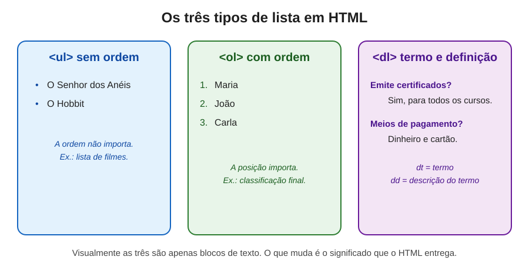
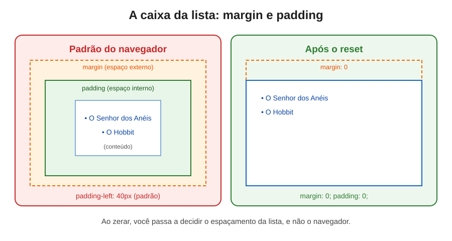
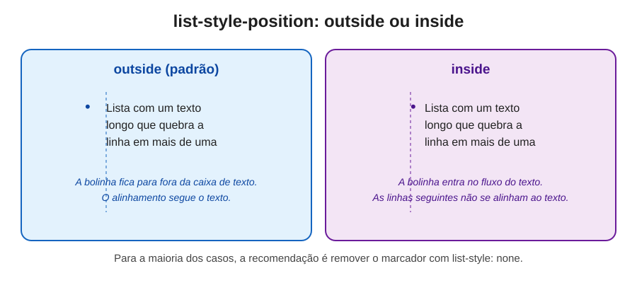

# Listas em HTML: como organizar informações e limpar o estilo padrão

> Uma documentação sobre os três tipos de lista do HTML, por que escolher cada um com cuidado e como remover o visual padrão do navegador para ter controle total do layout.



---

## Índice

- [Introdução: listas estão em toda parte](#introdução-listas-estão-em-toda-parte)
- [Parte 1: o que é uma lista e por que a semântica importa](#parte-1-o-que-é-uma-lista-e-por-que-a-semântica-importa)
- [Parte 2: a lista não ordenada (`ul`)](#parte-2-a-lista-não-ordenada-ul)
  - [2.1 Listas dentro de listas (aninhamento)](#21-listas-dentro-de-listas-aninhamento)
- [Parte 3: a lista ordenada (`ol`)](#parte-3-a-lista-ordenada-ol)
- [Parte 4: a lista de descrição (`dl`)](#parte-4-a-lista-de-descrição-dl)
- [Parte 5: regras de estrutura que evitam erros](#parte-5-regras-de-estrutura-que-evitam-erros)
- [Parte 6: a caixa da lista: margin e padding](#parte-6-a-caixa-da-lista-margin-e-padding)
- [Parte 7: removendo o marcador com `list-style`](#parte-7-removendo-o-marcador-com-list-style)
- [Parte 8: o caso da `dl` e da `dd`](#parte-8-o-caso-da-dl-e-da-dd)
- [Parte 9: listas e acessibilidade](#parte-9-listas-e-acessibilidade)
- [Parte 10: comparação lado a lado](#parte-10-comparação-lado-a-lado)
- [Parte 11: erros comuns e como evitá-los](#parte-11-erros-comuns-e-como-evitá-los)
- [Parte 12: como escolher o tipo certo](#parte-12-como-escolher-o-tipo-certo)
- [Parte 13: como testar você mesmo](#parte-13-como-testar-você-mesmo)
- [Glossário de termos técnicos](#glossário-de-termos-técnicos)
- [Referências e créditos](#referências-e-créditos)
- [Imagens desta documentação](#imagens-desta-documentação)

---

## Introdução: listas estão em toda parte

Pense no seu dia. A lista de compras no celular, os ingredientes de uma receita, os passos de um manual, as perguntas frequentes de um site, o menu de navegação que você usa sem pensar. Quase tudo que organizamos em sequência ou em grupo vira uma lista.

Na web, isso não é diferente. Estima-se que boa parte dos menus, rodapés e resultados de busca seja construída com listas. Por isso, escolher a lista certa, e não qualquer bloco de `div`, faz diferença na clareza da página e na experiência de quem depende de tecnologias assistivas.

Esta documentação percorre os três tipos de lista do HTML, mostra como limpar o visual padrão que o navegador aplica e explica o impacto de cada escolha para pessoas com deficiência visual.

> **Uma nota de empatia:** uma lista bem marcada conta uma história antes mesmo de ser lida. A pessoa sabe que existem três itens, sabe em que ordem eles estão e sabe se são termos com definições. Sem essa marcação, ela precisa montar esse mapa sozinha, linha por linha.

---

## Parte 1: o que é uma lista e por que a semântica importa

Uma **lista** é um conjunto de itens relacionados. No HTML, cada tipo de lista tem um **significado** próprio, e esse significado é o que mais importa.

Pense em duas caixas. Uma tem bolinhas, a outra tem números. Visualmente, a diferença é só o desenho. Mas, para quem usa leitor de tela, uma é "lista com três itens, sem ordem" e a outra é "lista ordenada com três itens". A informação de ordem, que é crucial em um ranking, só existe porque a tag informa.

Essa é a ideia central de toda a documentação: **escolha a lista pelo significado do conteúdo, e não pela aparência que ela deve ter.** A aparência é tarefa do CSS.

---

## Parte 2: a lista não ordenada (`ul`)

A tag `<ul>` (*unordered list*, ou lista não ordenada) é usada quando **a ordem dos itens não importa**. Ela é o tipo mais comum na web.

Cada item é marcado com `<li>` (*list item*, ou item de lista):

```html
<ul>
  <li>O Senhor dos Anéis</li>
  <li>O Hobbit</li>
</ul>
```

Por padrão, o navegador mostra cada item com uma bolinha (o marcador) e recuo à esquerda. Esse visual é só uma aparência, e voltaremos a ele na Parte 7.

**Quando usar:** lista de filmes, de categorias de um menu, de recursos de um produto, de benefícios de um serviço. Em todos esses casos, trocar a ordem dos itens não muda o sentido da informação.

### 2.1 Listas dentro de listas (aninhamento)

Uma lista pode conter outra. Isso se chama **aninhamento** (em inglês, *nesting*). É útil para mostrar hierarquia, como uma coleção de livros com os volumes de cada um:

```html
<ul>
  <li>O Senhor dos Anéis
    <ul>
      <li>A Sociedade do Anel</li>
      <li>As Duas Torres</li>
      <li>O Retorno do Rei</li>
    </ul>
  </li>
  <li>O Hobbit</li>
</ul>
```

Repare que a lista interna fica **dentro** do `<li>` do item pai, e não depois dele. Essa é a forma correta, e ela permite que o leitor de tela entenda que os volumes pertencem a "O Senhor dos Anéis".

Não há limite prático de níveis, mas listas muito profundas tornam a leitura cansativa. Em geral, dois ou três níveis já são suficientes.

---

## Parte 3: a lista ordenada (`ol`)

A tag `<ol>` (*ordered list*, ou lista ordenada) é usada quando **a posição de cada item importa**.

```html
<h2>Classificação Final</h2>
<ol>
  <li>Maria</li>
  <li>João</li>
  <li>Carla</li>
  <li>Pedro</li>
</ol>
```

O navegador numera os itens automaticamente, na ordem em que aparecem. Se você inserir um item no meio, a numeração se ajusta sozinha. Essa é uma das grandes vantagens da lista ordenada: você não precisa escrever os números manualmente.

**Quando usar:** rankings, passos de uma receita, etapas de um processo, classificações, ordem cronológica de eventos.

**Atributos úteis da `ol`:**

- `start`: define o número inicial. Útil quando a lista continua uma sequência anterior, como `<ol start="5">`.
- `reversed`: inverte a contagem, do maior número para o menor. Útil em rankings decrescentes.
- `type`: escolhe o estilo do marcador, como números romanos (`type="I"`) ou letras (`type="a"`). Esse atributo é considerado visual, e o CSS é o caminho recomendado hoje para isso.

**Um lembrete importante:** o estilo visual da numeração, como ser 1, 2, 3 ou ser I, II, III, não muda o significado da lista. O que importa é a **ordem**, e a tag `<ol>` já a informa.

---

## Parte 4: a lista de descrição (`dl`)

A tag `<dl>` (*description list*, ou lista de descrição) é o tipo menos conhecido. Ela é usada para **pares de termo e definição**. Pense em glossários, perguntas frequentes, dicionários e metadados, como "Autor: Tolkien".

Ela tem uma estrutura diferente das anteriores:

- `<dt>` (*description term*) marca o **termo**;
- `<dd>` (*description details*) marca a **definição** ou a descrição desse termo.

```html
<h2>Perguntas Frequentes</h2>
<dl>
  <dt>Quais os meios de pagamento?</dt>
  <dd>Dinheiro e cartão.</dd>

  <dt>Emite certificados?</dt>
  <dd>Sim, para todos os cursos.</dd>
</dl>
```

Uma gota de empatia aqui: a estrutura "pergunta e resposta" é exatamente como muitas pessoas buscam informação. Quem usa leitor de tela, ao ouvir "termo" seguido de "descrição", entende o formato antes de ouvir o conteúdo.

**Regras da especificação HTML:**

- Um termo pode ter mais de uma descrição, e uma descrição pode valer para mais de um termo.
- Desde o HTML5.2, os grupos de `dt` e `dd` podem ser envolvidos por uma `div`, o que ajuda na estilização. Isso é permitido pela especificação e é útil quando você precisa agrupar pares.

**Quando usar:** glossários, perguntas frequentes, fichas técnicas, metadados de um produto ou de um artigo.

---

## Parte 5: regras de estrutura que evitam erros

Listas têm regras de estrutura. Desrespeitá-las pode gerar comportamentos inesperados em navegadores e em leitores de tela.

- **`ul` e `ol` contêm apenas `li`** como filhos diretos. Não coloque texto solto, `div` ou `span` diretamente dentro delas.
- **`dl` contém apenas grupos de `dt` e `dd`** (ou `div` que os envolvem). Não use `li` dentro de `dl`.
- **`li` só faz sentido dentro de `ul`, `ol` ou `menu`.** Usá-lo sozinho, fora de uma lista, quebra a semântica.
- **Listas aninhadas ficam dentro de um `li`**, como na Parte 2.1.

```html
<!-- Errado: texto solto e div dentro de ul -->
<ul>
  Frutas
  <div>Maçã</div>
</ul>

<!-- Certo: cada item é um li -->
<ul>
  <li>Maçã</li>
  <li>Banana</li>
</ul>
```

Essas regras existem para que a estrutura seja previsível. Quando ela é, o navegador e a tecnologia assistiva conseguem contar, numerar e anunciar os itens corretamente.

---

## Parte 6: a caixa da lista: margin e padding

Antes de remover o visual padrão de uma lista, é preciso entender a **caixa** de um elemento. Todo elemento HTML é tratado pelo navegador como uma caixa retangular, composta por camadas:

- **Conteúdo (content):** o texto ou a imagem em si;
- **Padding (espaçamento interno):** o espaço entre o conteúdo e a borda da caixa;
- **Border (borda):** a linha que contorna a caixa;
- **Margin (margem ou espaçamento externo):** o espaço entre a caixa e os elementos ao redor.

Esse modelo é conhecido como **modelo de caixa** (*box model*), e é a base de como o CSS calcula o espaço de cada elemento.

Por padrão, navegadores aplicam às listas um **padding à esquerda de cerca de 40 pixels**, que recua os itens, e uma **margin superior e inferior** que separa a lista do que vem antes e depois. Esses valores variam um pouco entre navegadores, mas a ideia é a mesma.



Para ter controle total do espaçamento, muitos desenvolvedores zeram esses valores:

```css
ul,
ol {
  margin: 0;
  padding: 0;
}
```

Depois do reset, a lista não recua mais e não tem espaço externo extra. Se você quiser recuo ou espaçamento, agora você define o valor exato que quer, em vez de herdar o padrão do navegador.

**Uma observação:** o padrão de cada navegador existe para dar uma aparência razoável quando nenhum CSS é aplicado. Zerar esses valores não é errado. O erro é zerar sem depois definir o espaçamento de que o layout precisa, o que pode deixar os itens colados uns nos outros.

---

## Parte 7: removendo o marcador com `list-style`

O **marcador** (*marker*) é a bolinha, o número ou a letra que aparece antes de cada item. A propriedade que controla esse marcador é a `list-style`, que é um atalho para três outras:

- **`list-style-type`**: o tipo do marcador, como `disc` (bolinha cheia), `circle`, `square`, `decimal` (números) ou `none` (nenhum);
- **`list-style-position`**: a posição do marcador, `outside` ou `inside`;
- **`list-style-image`**: uma imagem personalizada como marcador.

```css
/* Remove o marcador */
ul {
  list-style: none;
}

/* Troca por um quadrado */
ul.quadrados {
  list-style-type: square;
}

/* Usa uma imagem como marcador */
ul.com-icone {
  list-style-image: url("icone.svg");
}
```

### outside ou inside?

A posição do marcador decide onde ele fica em relação ao texto:

- **`outside`** (o padrão): o marcador fica **fora** da caixa de texto, pendurado à esquerda. Se o item quebrar em várias linhas, as linhas seguintes se alinham ao texto, e não ao marcador.
- **`inside`**: o marcador entra **dentro** do fluxo do texto. Ele se comporta como se fosse uma letra a mais no início do item, e as linhas seguintes começam embaixo do marcador.



Na prática, o `outside` costuma ficar mais elegante, porque mantém o texto alinhado. Já o `inside` pode servir quando você quer que o marcador faça parte do próprio conteúdo.

### Por que zerar o marcador com `none`

A forma mais comum de limpar a lista é:

```css
ul,
ol {
  list-style: none;
}
```

Isso remove a bolinha ou a numeração. Muitas vezes isso é feito para dar lugar a um design próprio, como ícones em CSS ou uma lista de cards sem marcadores visuais.

**Atenção:** remover o marcador visual **não** deve significar remover a lista. Veremos na Parte 9 por que isso é importante para a acessibilidade.

---

## Parte 8: o caso da `dl` e da `dd`

Ao contrário de `ul` e `ol`, a `dl` não tem marcador por padrão. Ela não precisa de `list-style: none`, porque nunca teve bolinhas. Por isso, ao limpar uma `dl`, o foco está em outras propriedades:

- **Margin da `dl`:** navegadores costumam aplicar margin superior e inferior, mas não padding. Esse margin pode ser zerado, se o layout exigir.
- **Margin da `dd`:** esta é a diferença importante. Por padrão, a `dd` recebe uma margem à esquerda, que indenta a definição em relação ao termo. Esse recuo ajuda a diferenciar visualmente termo e descrição.

```css
dl {
  margin: 0;
}

dd {
  margin-left: 0; /* remove o recuo padrão da definição */
}
```

Se você quiser manter a hierarquia visual, mas com outro tamanho de recuo, basta ajustar o valor:

```css
dd {
  margin-left: 1.5rem;
}
```

**Lembrete:** a indentação é apenas visual. A relação entre o termo e a definição continua existindo na estrutura, mesmo que o recuo seja removido.

---

## Parte 9: listas e acessibilidade

Este é o ponto que transforma uma escolha técnica em uma decisão de inclusão.

### O que o leitor de tela faz com uma lista

Quando um leitor de tela encontra uma lista, ele anuncia algo como "lista com três itens". A pessoa pode então ir de item em item, pular a lista inteira ou saber quantos itens restam. Isso só acontece porque o HTML informa que aquilo é uma lista.

Se a lista for feita apenas de `div`, o leitor lê uma sequência de textos sem relação aparente. A pessoa não sabe onde a lista começa, onde termina ou quantos itens existem.

### O cuidado com `list-style: none`

Existe um detalhe importante que a própria documentação do MDN registra: em alguns navegadores, como o Safari, remover o marcador com `list-style: none` pode fazer com que a lista perca seu significado para o VoiceOver. Ou seja, o visual some, mas a semântica também.

A solução mais usada é reforçar o papel da lista com o atributo `role`:

```html
<ul role="list" class="menu">
  <li><a href="/sobre">Sobre</a></li>
  <li><a href="/contato">Contato</a></li>
</ul>
```

O `role="list"` diz explicitamente ao navegador que aquilo é uma lista, mesmo com o marcador removido. Ele é um reforço útil, e não substitui a tag correta: a regra continua sendo usar `ul` ou `ol` sempre que possível.

**Em resumo:** quando zerar o marcador, teste com um leitor de tela no navegador que você usa, e considere o `role="list"` como garantia extra.

---

## Parte 10: comparação lado a lado

| Situação | Com lista semântica | Sem lista semântica (só `div`) |
|---|---|---|
| Leitor de tela encontra o conjunto | Anuncia "lista com N itens" | Lê textos soltos, sem saber que são um grupo |
| Navegar entre itens | Pode ir de item em item e pular a lista | Precisa passar por todo o texto |
| Informar a ordem | `ol` numera e comunica a sequência | Os números precisam ser escritos à mão |
| Glossário ou perguntas frequentes | `dl`, com termo e definição ligados | Sequência de blocos sem relação clara |
| Manutenção | Inserir um item renumera tudo sozinho | Cada número precisa ser ajustado |
| Visual padrão | Bolinhas ou números automáticos | Nenhum marcador, a menos que seja criado |
| Controle do layout | Reset com margin, padding e list-style | O mesmo controle, mas sem significado |

Note que a lista semântica não impede nenhuma personalização visual. Você continua podendo remover marcadores, mudar espaçamentos e criar designs próprios. A diferença é que, ao fazer isso, o significado continua preservado.

---

## Parte 11: erros comuns e como evitá-los

Aprender com erros é um dos caminhos mais rápidos para dominar um assunto. Esta seção reúne os equívocos mais frequentes com listas.

### Erro 1: escolher `ul` quando a ordem importa

**O que acontece:** um ranking ou uma sequência de passos aparece com bolinhas, e a ordem se perde para quem usa leitor de tela.

**Como corrigir:** se a posição de cada item tem significado, use `ol`.

### Erro 2: numerar à mão dentro de `ul`

```html
<!-- Errado: números digitados dentro de uma lista não ordenada -->
<ul>
  <li>1. Maria</li>
  <li>2. João</li>
</ul>

<!-- Certo: a ol numera automaticamente -->
<ol>
  <li>Maria</li>
  <li>João</li>
</ol>
```

**Por que é um problema:** os números escritos à mão não se atualizam se um item for inserido ou removido, e o leitor de tela pode ler o número duas vezes.

### Erro 3: lista aninhada fora do `li`

```html
<!-- Errado: a lista interna está solta, fora do item -->
<ul>
  <li>O Senhor dos Anéis</li>
  <ul>
    <li>A Sociedade do Anel</li>
  </ul>
</ul>

<!-- Certo: a lista interna fica dentro do li do item pai -->
<ul>
  <li>O Senhor dos Anéis
    <ul>
      <li>A Sociedade do Anel</li>
    </ul>
  </li>
</ul>
```

### Erro 4: usar `li` dentro de `dl`

**O que acontece:** a estrutura de termo e definição se perde, e o navegador pode interpretar o conteúdo de forma inesperada.

**Como corrigir:** use `dt` para o termo e `dd` para a descrição.

### Erro 5: remover o marcador e esquecer a semântica

**O que acontece:** a lista perde a bolinha e, em alguns navegadores, também perde o papel de lista para o leitor de tela.

**Como corrigir:** mantenha a tag correta e, se necessário, adicione `role="list"`, como na Parte 9.

### Erro 6: zerar o padding sem definir espaçamento

**O que acontece:** a lista fica colada no restante da página, e os itens perdem a respiração visual.

**Como corrigir:** depois do reset, defina explicitamente o espaçamento de que o layout precisa, com `margin` ou `gap` nos itens.

### Erro 7: usar lista para tudo

**O que acontece:** blocos que não são um conjunto de itens relacionados viram listas por hábito, o que polui a estrutura e confunde quem lê com leitor de tela.

**Como corrigir:** use lista quando houver um conjunto real de itens. Para um bloco isolado de texto, um parágrafo ou um `div` costuma ser suficiente.

---

## Parte 12: como escolher o tipo certo

Use este guia rápido para decidir:

| Pergunta | Resposta | Tag |
|---|---|---|
| Os itens formam um conjunto sem ordem? | Sim | `ul` |
| A posição de cada item tem significado? | Sim | `ol` |
| O conteúdo é formado por pares de termo e definição? | Sim | `dl` |
| Preciso de hierarquia dentro de um item? | Sim | `ul` ou `ol` aninhada dentro do `li` |
| É um único item ou um texto corrido? | Sim | Parágrafo `p`, sem lista |

Uma pergunta que ajuda muito: **se eu trocar a ordem dos itens, o sentido muda?** Se a resposta for não, use `ul`. Se for sim, use `ol`.

---

## Parte 13: como testar você mesmo

### Teste visual, sem CSS

Desative o CSS do site, ou abra a página sem estilos, e observe se as listas continuam organizadas. Se a hierarquia e a ordem permanecem claras, a estrutura está correta.

### Teste com o inspetor de acessibilidade

No navegador, clique com o botão direito em uma lista e escolha **Inspecionar**. Na aba de acessibilidade, procure o papel "lista" e veja quantos itens ela contém. Isso mostra o que a tecnologia assistiva recebe, mesmo que o marcador tenha sido removido.

### Teste com leitor de tela

Ative um leitor de tela, como o VoiceOver (no Mac, com Command + F5) ou o NVDA (gratuito, no Windows), e navegue até a lista. Confira se o leitor anuncia o número de itens e se consegue percorrê-los um a um.

### Teste com ferramentas automáticas

Ferramentas como o **axe DevTools** e o **WAVE** identificam estruturas de lista incorretas, como `li` fora de lista ou `div` com comportamento de item.

---

## Glossário de termos técnicos

**Aninhamento (nesting):** colocar um elemento dentro de outro do mesmo tipo ou de tipo relacionado, como uma lista dentro de um item de lista.

**Box model (modelo de caixa):** forma como o navegador calcula o espaço de um elemento, somando conteúdo, padding, border e margin.

**`dd` (description details):** elemento que marca a definição ou a descrição de um termo dentro de uma `dl`.

**`dl` (description list):** lista de descrição, formada por pares de termo e definição.

**`dt` (description term):** elemento que marca o termo dentro de uma `dl`.

**`li` (list item):** item de lista, usado dentro de `ul`, `ol` e `menu`.

**List-style:** propriedade CSS que controla o marcador de um item de lista, com atalhos para tipo, posição e imagem.

**Marcador (marker):** a bolinha, o número ou a letra que aparece antes de cada item de uma lista.

**Margin (margem):** espaço externo de um elemento, entre ele e os elementos ao redor.

**`ol` (ordered list):** lista ordenada, em que a posição de cada item tem significado.

**Padding (espaçamento interno):** espaço entre o conteúdo de um elemento e a sua borda.

**`role`:** atributo que declara o papel de um elemento para tecnologias assistivas. Pode ser usado como reforço, como em `role="list"`.

**`ul` (unordered list):** lista não ordenada, em que a ordem dos itens não importa.

---

## Referências e créditos

As informações desta documentação foram parafraseadas a partir das fontes abaixo. Sempre que possível, consulte o original para aprofundamento.

### Documentações oficiais

- **WHATWG – HTML Living Standard**, especificação viva do HTML, mantida pelo WHATWG. Define o significado de `ul`, `ol`, `li`, `dl`, `dt` e `dd`, incluindo as regras de estrutura e os atributos `start` e `reversed`. Disponível em: https://html.spec.whatwg.org/multipage/grouping-content.html

- **MDN Web Docs – Elemento `ul`**, documentação da Mozilla, com contribuições de sua comunidade. Disponível em: https://developer.mozilla.org/pt-BR/docs/Web/HTML/Element/ul

- **MDN Web Docs – Elemento `ol`**. Disponível em: https://developer.mozilla.org/pt-BR/docs/Web/HTML/Element/ol

- **MDN Web Docs – Elemento `dl`**. Disponível em: https://developer.mozilla.org/pt-BR/docs/Web/HTML/Element/dl

- **MDN Web Docs – Propriedade `list-style`**, incluindo a observação sobre a perda de semântica de listas em alguns navegadores e o uso de `role="list"`. Disponível em: https://developer.mozilla.org/pt-BR/docs/Web/CSS/list-style

- **MDN Web Docs – Modelo de caixa (box model)**, explicação de conteúdo, padding, border e margin. Disponível em: https://developer.mozilla.org/pt-BR/docs/Learn/CSS/Building_blocks/The_box_model

- **W3C – CSS Lists and Counters Module Level 3**, especificação do CSS para listas e contadores, incluindo os tipos de marcador e a posição do marcador. Disponível em: https://www.w3.org/TR/css-lists-3/

- **W3C – CSS Box Model Module Level 3**, especificação oficial do modelo de caixa. Disponível em: https://www.w3.org/TR/css-box-3/

- **W3C – WCAG 2.2**, critérios de acessibilidade relacionados, especialmente o 1.3.1 (Informações e Relações), que trata de estruturas semânticas como listas. Disponível em: https://www.w3.org/TR/WCAG22/

- **W3C – WAI-ARIA, papel `list`**, definição do papel de lista para tecnologias assistivas. Disponível em: https://www.w3.org/TR/wai-aria-1.2/#list

- **web.dev – Learn Accessibility**, curso gratuito do Google sobre acessibilidade. Disponível em: https://web.dev/learn/accessibility

### Ferramentas recomendadas

- **axe DevTools**, extensão para encontrar problemas de acessibilidade em páginas.
- **WAVE**, da WebAIM, para verificar estrutura e erros de acessibilidade. Disponível em: https://wave.webaim.org
- **NVDA**, leitor de tela gratuito para Windows, desenvolvido pela NV Access. Disponível em: https://www.nvaccess.org

---

## Imagens desta documentação

As imagens estão na pasta `imagens/` e podem ser baixadas separadamente:

1. `imagens/07-tipos-de-lista.svg`: os três tipos de lista, `ul`, `ol` e `dl`, com exemplos.
2. `imagens/08-reset-margin-padding.svg`: a caixa da lista antes e depois de zerar margin e padding.
3. `imagens/09-list-style-position.svg`: diferença entre `list-style-position` `outside` e `inside`.

---

**Para concluir:** a lista é uma das estruturas mais simples do HTML, e também uma das mais poderosas. Escolher entre `ul`, `ol` e `dl` é dizer ao mundo o que os itens representam. Limpar o visual com CSS é dar a eles a aparência que o projeto precisa, sem perder esse significado. Quando as duas coisas caminham juntas, a página fica bonita para quem enxerga e clara para quem ouve.