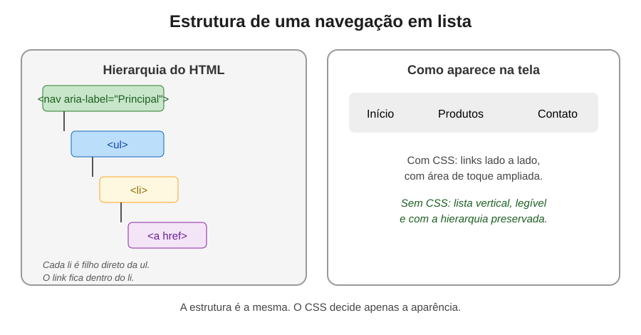
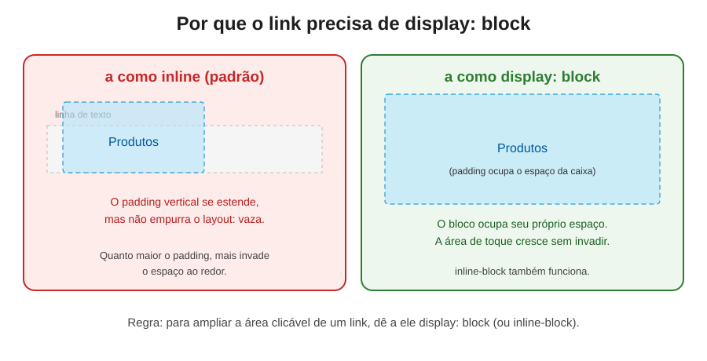

# Navegação em lista: estrutura, estilo e acessibilidade

> Uma documentação sobre como construir o menu de um site com HTML semântico, transformá-lo em uma barra horizontal com CSS e entender por que essa escolha impacta quem navega com leitor de tela.




---

## Índice

- [Introdução: o menu que você usa todo dia](#introdução-o-menu-que-você-usa-todo-dia)
- [Parte 1: por que a navegação é uma lista](#parte-1-por-que-a-navegação-é-uma-lista)
- [Parte 2: montando a estrutura em HTML](#parte-2-montando-a-estrutura-em-html)
- [Parte 3: limpando o estilo padrão da lista](#parte-3-limpando-o-estilo-padrão-da-lista)
- [Parte 4: colocando os itens lado a lado com flexbox](#parte-4-colocando-os-itens-lado-a-lado-com-flexbox)
  - [4.1 Separando os itens: gap ou margin](#41-separando-os-itens-gap-ou-margin)
- [Parte 5: deixando o link fácil de clicar](#parte-5-deixando-o-link-fácil-de-clicar)
  - [5.1 Por que o padding do link vazava](#51-por-que-o-padding-do-link-vazava)
  - [5.2 A solução: display block](#52-a-solução-display-block)
- [Parte 6: o que o leitor de tela anuncia](#parte-6-o-que-o-leitor-de-tela-anuncia)
- [Parte 7: navegação em lista ou sem lista?](#parte-7-navegação-em-lista-ou-sem-lista)
- [Parte 8: comparação lado a lado](#parte-8-comparação-lado-a-lado)
- [Parte 9: erros comuns e como evitá-los](#parte-9-erros-comuns-e-como-evitá-los)
- [Parte 10: como testar você mesmo](#parte-10-como-testar-você-mesmo)
- [Glossário de termos técnicos](#glossário-de-termos-técnicos)
- [Referências e créditos](#referências-e-créditos)
- [Imagens desta documentação](#imagens-desta-documentação)

---

## Introdução: o menu que você usa todo dia

Quase todo site tem uma navegação. É a barra de cima com "Início", "Produtos", "Contato", o menu que abre no celular, o conjunto de links no rodapé. Você passa por ela sem pensar, mas ela é o mapa do site: é por ali que a pessoa decide onde quer ir.

Essa peça tão comum esconde várias decisões. Qual tag usar? Como organizar os links? Como transformar uma lista vertical em uma barra horizontal? E, talvez a mais importante: como a pessoa que usa um leitor de tela vai perceber essa navegação?

Esta documentação percorre esse caminho, do HTML ao CSS, passando pela acessibilidade. Também apresenta uma discussão real da comunidade de desenvolvedores sobre usar ou não listas em menus, com as posições de cada lado.

> **Uma nota de empatia:** a navegação é o primeiro lugar onde uma pessoa que usa leitor de tela se orienta. Se ela entende rapidamente o que existe e quantas opções há, consegue chegar ao conteúdo. Se não entende, pode desistir antes de começar.

---

## Parte 1: por que a navegação é uma lista

Uma navegação é, essencialmente, **um conjunto de links**. Esses links levam a outras partes do site e, normalmente, não têm uma ordem que altere o sentido: "Sobre" não é mais importante que "Contato" por estar antes na lista.

Por isso, a estrutura mais usada para navegação é a **lista não ordenada** (`ul`). A tag `ul` comunica "estes itens formam um grupo, sem ordem específica", e cada `li` representa um item desse grupo.

Essa ideia já foi apresentada na documentação sobre listas. Aqui, o foco é aplicá-la a um caso real, que é o menu.

Uma observação importante: uma lista não serve só para links. Dentro de um `li`, você pode colocar títulos, parágrafos, imagens e outros elementos. Isso dá muita liberdade para montar um menu rico, como um cartão com imagem e descrição. A lista define a estrutura, e o conteúdo de cada item pode variar.

---

## Parte 2: montando a estrutura em HTML

A estrutura básica de uma navegação combina três tags que já conhecemos:

- `nav`, que marca o bloco de navegação como um ponto de referência;
- `ul`, que organiza os links em uma lista;
- `li`, que representa cada item, com um `a` dentro dele.

```html
<nav aria-label="Principal">
  <ul>
    <li><a href="/sobre">Sobre</a></li>
    <li><a href="/produtos">Produtos</a></li>
    <li><a href="/contato">Contato</a></li>
  </ul>
</nav>
```

Vamos entender cada parte:

- **`nav`** cria a região de navegação. Ela aparece no menu de pontos de referência do leitor de tela, e a pessoa pode pular direto para ela.
- **`aria-label="Principal"`** dá um nome à navegação. Isso é importante quando a página tem mais de uma `nav`, como um menu principal e um menu do rodapé. Sem nome, as duas aparecem como "navegação", e a pessoa não sabe qual é qual.
- **`ul` e `li`** organizam os links como um conjunto. Cada `li` é filho direto da `ul`.
- **`a`** é o link propriamente dito. O texto dentro dele é o que a pessoa ouve e clica. Ele é colocado dentro do `li`, nunca solto dentro da `ul`.

Mesmo sem nenhum CSS, essa estrutura já funciona: os links aparecem em uma lista vertical, com bolinhas e recuo, bem organizados.

### Por que não colocar os links direto na `nav`?

Você pode escrever apenas os links dentro da `nav`, sem a lista. Isso funciona visualmente, mas os itens ficam sem agrupamento no HTML. Sem CSS, os links aparecem um depois do outro, muitas vezes colados. A lista dá organização natural, mesmo quando o estilo falha.

Essa é uma das razões que fazem a lista ser a escolha mais recomendada, tema que discutiremos na Parte 7.

---

## Parte 3: limpando o estilo padrão da lista

O navegador aplica à `ul` um marcador (a bolinha) e espaçamentos próprios. Para ter controle total do menu, o primeiro passo é zerar esses valores:

```css
nav ul {
  list-style: none;
  margin: 0;
  padding: 0;
}
```

Cada propriedade tem uma função:

- **`list-style: none`** remove o marcador. Se você não quer bolinhas, elas saem.
- **`margin: 0`** remove o espaço externo da lista, aquele que a separa dos elementos ao redor.
- **`padding: 0`** remove o espaço interno, que costuma recuar os itens.

Depois desse reset, a lista ocupa exatamente o espaço que você definir. Se a navegação ficar colada em outro elemento, basta adicionar margem de forma intencional.

Uma observação: remover o marcador visual não remove a lista semanticamente. Veremos na Parte 6 o cuidado que isso exige.

---

## Parte 4: colocando os itens lado a lado com flexbox

Por padrão, os `li` aparecem um embaixo do outro, porque cada um é um bloco. Para transformar a lista em uma barra horizontal, usamos o **flexbox**.

O **flexbox** (*flexible box layout*) é um modo de layout do CSS que organiza os filhos de um elemento em uma linha ou em uma coluna, distribuindo o espaço entre eles. Para ativá-lo, basta declarar o elemento pai com `display: flex`:

```css
nav ul {
  display: flex;
  list-style: none;
  margin: 0;
  padding: 0;
}
```

Agora os `li` ficam lado a lado. Repare que o `display: flex` foi colocado na **`ul`**, que é o pai. Os itens que se organizam são os `li`, que passam a ser chamados de **itens flex** (*flex items*).

Essa distinção é fundamental, e vamos usá-la daqui para a frente: quem é o pai, e quem são os filhos que o flexbox organiza.

### 4.1 Separando os itens: gap ou margin

Com os itens lado a lado, eles podem ficar grudados. Há três formas comuns de separá-los.

**Opção 1: `gap`.** É a forma mais limpa. A propriedade `gap`, aplicada ao contêiner flex, cria um espaço entre os itens, sem afetar as bordas externas:

```css
nav ul {
  display: flex;
  gap: 20px;
}
```

**Opção 2: `margin-right` nos itens.** Funciona, mas cria espaço também depois do último item, o que pode deslocar o layout:

```css
nav li {
  margin-right: 20px; /* sobra espaço também após o último item */
}
```

**Opção 3: `margin` simétrica.** Dá espaço igual para todos os lados de cada item, separando os itens de forma uniforme:

```css
nav li {
  margin: 0 10px; /* 10px à esquerda e à direita de cada item */
}
```

Historicamente, o `gap` no flexbox teve suporte mais lento que outras propriedades. Hoje, ele é suportado pelos navegadores modernos. Ainda assim, vale conferir a compatibilidade do seu público no [Can I Use](https://caniuse.com/flexbox-gap), principalmente se o projeto atende navegadores antigos.

---

## Parte 5: deixando o link fácil de clicar

Um link pequeno é difícil de acertar, principalmente no celular, com o dedo. Ampliar a **área de toque** (ou área clicável) é uma boa prática de usabilidade e de acessibilidade, porque beneficia pessoas com tremores, com baixa destreza motora e com telas pequenas.

A forma mais comum de ampliar essa área é dar ao link um `padding`:

```css
nav a {
  text-decoration: none;
  color: #000;
  background-color: #eee;
  padding: 10px 20px;
}
```

Aqui aparecem três propriedades úteis:

- **`text-decoration: none`** remove o sublinhado padrão do link.
- **`background-color`** pinta o fundo do link, o que deixa a área clicável visível. Durante o desenvolvimento, uma cor forte, como azul claro, ajuda a enxergar exatamente onde a área começa e termina.
- **`padding`** cria espaço interno entre o texto e a borda do link, aumentando a área que responde ao clique.

### 5.1 Por que o padding do link vazava

Ao aumentar muito o `padding` vertical de um link, ele "vaza" para fora do espaço que deveria ocupar, invadindo o conteúdo ao redor. Isso acontece porque o `a` é, por padrão, um elemento **inline**.

Um elemento inline se comporta como uma palavra dentro de um parágrafo. Ele ocupa só o espaço do próprio texto, e não se organiza em caixas. Quando você dá a ele `padding` vertical, esse espaço aparece visualmente, mas **não empurra** os elementos vizinhos. O resultado é que o fundo do link se sobrepõe ao que está em volta.



Outro ponto que costuma confundir: o `display: flex` foi declarado na `ul`, e os flex items são os `li`. O `a` dentro do `li` não é um flex item. Ele continua sendo inline, mesmo dentro de um contêiner flex.

### 5.2 A solução: display block

Para resolver o vazamento, basta fazer o link se comportar como uma caixa:

```css
nav a {
  display: block;
  padding: 10px 20px;
}
```

Com `display: block`, o link ocupa seu próprio espaço, o `padding` é contabilizado no tamanho da caixa e nada invade o conteúdo ao redor. Você também pode usar `display: inline-block`, que mantém o link na linha de texto, mas permite definir altura e espaçamento como em uma caixa. Ambos resolvem o problema, e a escolha depende do layout.

**Uma dica prática:** ao estilizar links de navegação, comece com `display: block` e ajuste depois. Isso evita a maior parte dos problemas de área clicável.

---

## Parte 6: o que o leitor de tela anuncia

Esta é a parte que conecta o código à experiência real de quem usa a tecnologia assistiva.

### O que muda quando a navegação é uma lista

Ao entrar em uma navegação marcada como lista, o leitor de tela informa que a pessoa está em uma navegação e, em seguida, anuncia que é uma **lista de três itens**, por exemplo. A pessoa sabe, desde o início, quantas opções existem.

Isso importa bastante em navegações longas. Imagine uma navegação com quarenta itens. Se o leitor não anuncia o total, a pessoa não tem ideia de quanto ainda falta ao caminhar pelos links. Com a lista, ela sabe que está no segundo item de três, ou no vigésimo item de quarenta.

Durante a navegação, o leitor também anuncia a posição de cada item, como "dois de três", e o fato de ser um link. Se o link já foi visitado, o leitor costuma informar isso também. Esse comportamento é nativo do HTML: basta marcar o `a`, e a tecnologia assistiva faz o resto.

### O ruído das repetições

Existe um lado negativo, e ele também merece atenção. Como cada item é anunciado com sua posição ("um de três", "dois de três"), uma navegação curta pode gerar um ruído extra. Em um menu com três itens, a pessoa já percorre tudo rapidamente. Para ela, o anúncio "lista de três itens" pode parecer desnecessário.

Essa é justamente a principal crítica à navegação em lista, e ela é discutida na Parte 7.

### O cuidado com `list-style: none`

Quando você remove o marcador com `list-style: none`, algumas combinações de navegador e leitor de tela podem deixar de anunciar a lista. Um teste publicado no blog 456 Berea Street em 2011 registrou esse comportamento em alguns cenários: o marcador sumia visualmente e, com ele, parte do anúncio da lista.

Por isso, a recomendação prática é reforçar o papel da lista com `role="list"`:

```html
<nav aria-label="Principal">
  <ul role="list">
    <li><a href="/sobre">Sobre</a></li>
    <li><a href="/produtos">Produtos</a></li>
    <li><a href="/contato">Contato</a></li>
  </ul>
</nav>
```

O MDN, na documentação da propriedade `list-style`, também registra esse cuidado e recomenda o uso do `role="list"` nesses casos. Teste com o leitor de tela que você usa, porque o comportamento pode variar.

---

## Parte 7: navegação em lista ou sem lista?

Esta é a parte mais debatida da comunidade. Em janeiro de 2013, **Chris Coyier**, criador do site CSS-Tricks, publicou o artigo *Navigation in Lists: To Be or Not To Be*, argumentando que as navegações poderiam ser feitas sem lista. Ele se baseou em relatos de usuários de leitor de tela que preferiam navegar sem lista, com destaque para o caso de Reinhard Stebner, que usa o leitor JAWS e afirmou que a navegação em lista dificultava seu uso.

O artigo gerou uma discussão grande, com centenas de comentários. Depois, Coyier publicou um resumo, *Wrapup of Navigation in Lists*, com as conclusões a partir dos comentários. Nele, a conclusão mudou: a lista se mostrou a escolha mais equilibrada para a maioria dos casos.

### Os argumentos a favor da lista

Segundo o resumo da discussão, e das reações de outros desenvolvedores e pessoas que usam leitor de tela:

- **Estrutura natural de hierarquia:** submenus são muito mais fáceis de construir com listas aninhadas do que sem elas.
- **Padrão conhecido:** a maioria das pessoas que usam leitor de tela já está acostumada a ouvir que uma navegação é uma lista.
- **Informação de quantidade:** o anúncio "lista de N itens" ajuda a pessoa a se orientar.
- **Funciona mesmo sem CSS:** uma lista continua organizada quando o estilo não carrega.
- **Semântica explícita:** a tag `ul` comunica a estrutura com clareza.

### Os argumentos a favor de não usar lista

- **Marcação mais simples:** `nav > a` é menos código do que `nav > ul > li > a`.
- **Menos ruído na fala:** o leitor não repete "um de três", "dois de três" a cada item.
- **Preferência de alguns usuários:** pelo menos um usuário de leitor de tela, relatado na discussão, afirmou preferir navegações sem lista.
- **Possibilidade com ARIA:** divs e spans também podem ser úteis, especialmente com papéis ARIA adequados.

### Por que a comunidade concluiu que a lista é melhor como padrão

A discussão deixou algumas lições importantes:

1. **Uma opinião não representa todos os usuários.** O próprio Coyier admitiu que não era especialista em leitores de tela e que a melhor forma de decidir seria ouvir mais pessoas que os utilizam. Ele afirmou que manteria a posição apenas até que surgisse uma pesquisa sólida em sentido contrário.
2. **A diferença entre os leitores de tela é grande.** Alguns tratam listas e não listas de forma idêntica, como no teste feito com o VoiceOver. Outros, como o JAWS em versões antigas, tinham comportamentos diferentes.
3. **Estrutura gera benefícios que vão além do leitor de tela.** A lista ajuda a hierarquia, o CSS, a manutenção e o fallback sem estilo.
4. **O padrão é o que o usuário espera.** Ao usar a convenção mais comum, a maioria das pessoas fica mais confortável.
5. **Não existe verdade absoluta.** Teste, pesquise e ouça usuários reais.

Essa última lição é a mais importante. Ela vale para qualquer decisão de acessibilidade: não aceite nenhuma afirmação como absoluta, nem a desta documentação. Verifique, teste com o leitor de tela que você usa e, sempre que possível, converse com pessoas que dependem dessas tecnologias.

### A recomendação

Use **lista para navegação** como padrão. É a forma mais comum, a mais compreendida e a que oferece mais benefícios combinados. Se houver uma necessidade específica, como um menu muito simples em que o anúncio de lista atrapalha, você pode considerar a alternativa, mas com testes reais.

---

## Parte 8: comparação lado a lado

| Situação | Navegação em lista (`nav > ul > li > a`) | Navegação sem lista (`nav > a`) |
|---|---|---|
| Leitor de tela entra na navegação | Anuncia que é uma lista e quantos itens há | Anuncia a navegação, sem contagem |
| Percorrer os itens | Informa a posição de cada item | Pode ser mais rápido em menus pequenos |
| Submenus e hierarquia | Simples, com listas aninhadas | Mais difícil de organizar |
| Sem CSS | Continua organizada, em lista vertical | Links podem ficar colados |
| Quantidade de código | Maior | Menor |
| Padrão da comunidade | Mais comum e mais recomendado | Menos comum |
| Consistência entre leitores | Pode variar, exige teste | Pode variar, exige teste |

---

## Parte 9: erros comuns e como evitá-los

### Erro 1: colocar o `display: flex` no `li` em vez de na `ul`

**O que acontece:** nada muda visualmente, porque o `li` sozinho não organiza os filhos dele em linha.

**Como corrigir:** aplique `display: flex` no pai, que é a `ul`. Os `li` passam a ser os itens flex.

### Erro 2: achar que o padding do link vai empurrar os vizinhos

**O que acontece:** o link inline cresce visualmente, mas invade o espaço ao redor.

**Como corrigir:** dê ao link `display: block` (ou `inline-block`) antes de aumentar o padding.

### Erro 3: remover o marcador e a semântica juntos

**O que acontece:** a lista perde a bolinha e, em alguns casos, também o anúncio de lista para o leitor de tela.

**Como corrigir:** mantenha a tag `ul`, e reforce o papel com `role="list"` quando for remover o marcador.

### Erro 4: deixar várias navegações sem nome

**O que acontece:** o leitor anuncia "navegação" três vezes, e a pessoa não sabe qual é a principal.

**Como corrigir:** dê um `aria-label` diferente a cada `nav`, como "Principal" e "Rodapé".

### Erro 5: usar `div` no lugar de `nav` e `ul`

**O que acontece:** a navegação perde o significado. O leitor não reconhece a região nem a lista.

**Como corrigir:** use as tags semânticas, e estilize-as com CSS.

### Erro 6: esquecer o foco do teclado

**O que acontece:** o menu é usado com o mouse, mas quem navega pelo teclado não percebe onde está.

**Como corrigir:** mantenha o indicador de foco visível em cada link, e teste a navegação com Tab.

### Erro 7: definir uma área clicável muito pequena

**O que acontece:** o link é difícil de acertar no celular, e a pessoa acaba clicando no item vizinho.

**Como corrigir:** aumente a área com `display: block` e `padding`, e teste o toque em uma tela real.

---

## Parte 10: como testar você mesmo

### Teste sem CSS

Desative o CSS da página e observe a navegação. Ela ainda deve estar organizada, com os links em ordem e com a hierarquia visível.

### Teste com o leitor de tela

Ative um leitor de tela, como o VoiceOver (no Mac, com Command + F5) ou o NVDA (gratuito, no Windows). Entre na navegação e verifique:

- se o leitor anuncia o nome da região;
- se informa a quantidade de itens;
- se percorre cada link, com o texto correto;
- se o anúncio de lista aparece, mesmo com o marcador removido.

### Teste de teclado

Use a tecla Tab para percorrer os links. Confira se o foco é visível, se a ordem faz sentido e se é possível ativar cada link com Enter.

### Teste de área clicável

Use o navegador em modo de tela pequena, pelas ferramentas de desenvolvedor, e tente clicar nos links com o cursor. Se for difícil acertar, a área pode estar pequena demais.

---

## Glossário de termos técnicos

**Área de toque (touch target):** a região que responde a um toque ou clique. Quanto maior, mais fácil de acertar.

**Elemento inline:** elemento que ocupa apenas o espaço do próprio conteúdo, como um trecho de texto dentro de um parágrafo. O `a` é inline por padrão.

**Flex item:** qualquer filho direto de um contêiner com `display: flex`. Os flex items são organizados pelo flexbox.

**Flexbox (flexible box layout):** modo de layout do CSS que organiza elementos em linha ou em coluna, distribuindo o espaço entre eles.

**`gap`:** propriedade que cria espaço entre os itens de um contêiner flex ou grid, sem afetar as bordas externas.

**`inline-block`:** valor de `display` que mantém o elemento na linha de texto, mas permite definir altura e espaçamento como em um bloco.

**`nav` (navigation):** elemento que marca um bloco de navegação e cria um ponto de referência.

**Padding (espaçamento interno):** espaço entre o conteúdo de um elemento e sua borda.

**Ponto de referência:** região nomeada da página, que permite ao leitor de tela localizar áreas importantes, como a navegação.

**`role="list"`:** atributo que reforça o papel de lista para tecnologias assistivas, útil quando o marcador é removido com CSS.

---

## Referências e créditos

As informações desta documentação foram parafraseadas a partir das fontes abaixo. Sempre que possível, consulte o original para aprofundamento.

### O debate sobre listas em navegações

- **Chris Coyier**, criador do CSS-Tricks, autor de *Navigation in Lists: To Be or Not To Be* (29 de janeiro de 2013), artigo que inicia a discussão sobre navegação sem lista. Disponível em: https://css-tricks.com/navigation-in-lists-to-be-or-not-to-be/

- **Chris Coyier**, *Wrapup of Navigation in Lists*, resumo das conclusões após os comentários, com a posição final favorável às listas na maioria dos casos. Disponível em: https://css-tricks.com/wrapup-of-navigation-in-lists/

- **Adrian Roselli**, *Still Guessing on Accessibility* (janeiro de 2013), texto que questiona a falta de participação de pessoas que usam leitores de tela nesse debate e defende que a opinião delas seja ouvida. Disponível em: https://adrianroselli.com/2013/01/still-guessing-on-accessibility.html

- **Craig Buckler**, resumo da discussão publicado na SitePoint, com os principais argumentos de cada lado. Disponível em: https://www.sitepoint.com/are-navigation-lists-necessary

- **Léonie Watson**, citada no resumo de Louis Lazaris e na coleta de opiniões de usuários feita durante a discussão do CSS-Tricks.

- **Reinhard Stebner**, usuário de leitor de tela citado na discussão, que relatou preferir navegação sem lista ao usar o JAWS.

- **Chris Heilmann**, da Mozilla, citado nos comentários do artigo original, que observou que parte dos problemas com listas vinha dos leitores de tela da época, e não apenas da marcação.

### Estudos e artigos técnicos

- **Blog 456 Berea Street** (autor não identificado na fonte consultada), artigo *Screen readers, list items and list-style:none*, de 14 de setembro de 2011, que mostra que alguns leitores de tela deixam de anunciar itens de lista quando o marcador é removido. Disponível em: https://www.456bereastreet.com/archive/201109/screen_readers_list_items_and_list-stylenone

- **Benney Au**, *Making Your Website's Lists Screen-reader Friendly*, guia publicado na Pluralsight em 2020, com orientações práticas para listas acessíveis. Disponível em: https://www.pluralsight.com/resources/blog/guides/making-your-websites-lists-screen-reader-friendly

### Documentações oficiais

- **MDN Web Docs – Elemento `nav`**, documentação da Mozilla sobre a tag de navegação. Disponível em: https://developer.mozilla.org/pt-BR/docs/Web/HTML/Element/nav

- **MDN Web Docs – Propriedade `list-style`**, com a observação sobre a perda de semântica de listas em alguns navegadores e o uso de `role="list"`. Disponível em: https://developer.mozilla.org/pt-BR/docs/Web/CSS/list-style

- **MDN Web Docs – Flexbox**, guia de layout flexível do CSS. Disponível em: https://developer.mozilla.org/pt-BR/docs/Learn/CSS/CSS_layout/Flexbox

- **MDN Web Docs – Modelo de caixa (box model)**, explicação de conteúdo, padding, border e margin. Disponível em: https://developer.mozilla.org/pt-BR/docs/Learn/CSS/Building_blocks/The_box_model

- **WHATWG – HTML Living Standard**, especificação da tag `nav` e das listas. Disponível em: https://html.spec.whatwg.org/

- **W3C – WAI-ARIA 1.2, papel `navigation`**, definição do papel de navegação para tecnologias assistivas. Disponível em: https://www.w3.org/TR/wai-aria-1.2/#navigation

- **W3C – WAI-ARIA 1.2, papel `list`**, definição do papel de lista. Disponível em: https://www.w3.org/TR/wai-aria-1.2/#list

- **W3C – WCAG 2.2**, em especial o critério 1.3.1 (Informações e Relações) e o critério 2.5.8 (Tamanho do alvo, nível AA), que trata do tamanho mínimo de áreas clicáveis. Disponível em: https://www.w3.org/TR/WCAG22/

---

## Imagens desta documentação

As imagens estão na pasta `./src/assets/images/` e podem ser baixadas separadamente:

1. `./src/assets/images/10-estrutura-navegacao-lista.svg`: hierarquia da navegação em HTML e como ela aparece na tela.
2. `./src/assets/images/11-inline-x-block-padding.svg`: diferença entre o link inline e o link como bloco, e o motivo do vazamento do padding.
3. `./src/assets/images/12-debate-lista-ou-nao.svg`: resumo dos argumentos favoráveis e contrários à navegação em lista.

---

**Para concluir:** uma navegação é a porta de entrada do site. Quando ela é construída com uma lista, a estrutura fica clara para quem enxerga, para quem usa leitor de tela e para quem precisa de um layout que funcione sem estilo. A discussão da comunidade mostra que a melhor decisão nasce de testes reais e da escuta de quem usa a tecnologia no dia a dia.