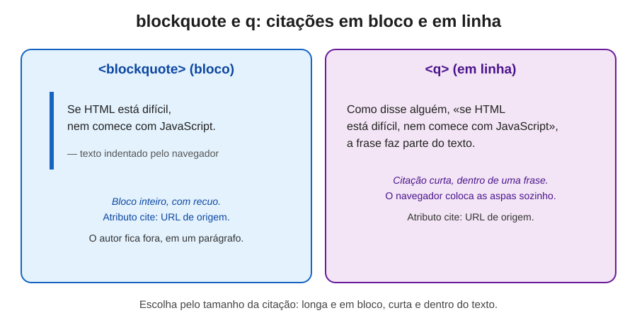
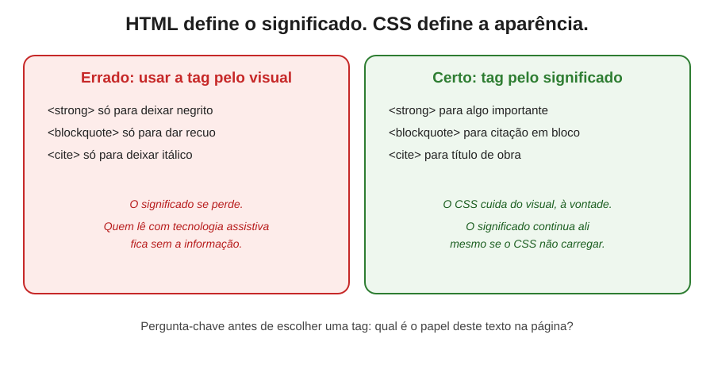

# Citações e ênfase em HTML: `blockquote`, `q`, `cite`, `em` e `strong`

> Uma documentação sobre as tags que dão significado às palavras do texto, quando citar alguém, quando destacar uma palavra e por que o HTML deve dizer o que o texto é, deixando a aparência para o CSS.




---

## Índice

- [Introdução: palavras que carregam sentido](#introdução-palavras-que-carregam-sentido)
- [Parte 1: a regra que atravessa tudo: HTML é significado, CSS é aparência](#parte-1-a-regra-que-atravessa-tudo-html-é-significado-css-é-aparência)
- [Parte 2: `blockquote`, a citação em bloco](#parte-2-blockquote-a-citação-em-bloco)
  - [2.1 Onde colocar o autor](#21-onde-colocar-o-autor)
- [Parte 3: `q`, a citação em linha](#parte-3-q-a-citação-em-linha)
- [Parte 4: `cite`, o título de uma obra](#parte-4-cite-o-título-de-uma-obra)
- [Parte 5: `em`, a ênfase de fala](#parte-5-em-a-ênfase-de-fala)
- [Parte 6: `strong`, a importância](#parte-6-strong-a-importância)
- [Parte 7: `em` ou `strong`? Como decidir](#parte-7-em-ou-strong-como-decidir)
- [Parte 8: o atributo `cite` em `blockquote` e `q`](#parte-8-o-atributo-cite-em-blockquote-e-q)
- [Parte 9: o que muda para quem usa leitor de tela](#parte-9-o-que-muda-para-quem-usa-leitor-de-tela)
- [Parte 10: comparação lado a lado](#parte-10-comparação-lado-a-lado)
- [Parte 11: erros comuns e como evitá-los](#parte-11-erros-comuns-e-como-evitá-los)
- [Parte 12: como testar você mesmo](#parte-12-como-testar-você-mesmo)
- [Glossário de termos técnicos](#glossário-de-termos-técnicos)
- [Referências e créditos](#referências-e-créditos)
- [Imagens desta documentação](#imagens-desta-documentação)

---

## Introdução: palavras que carregam sentido

Em um texto, algumas palavras pedem atenção especial. Uma frase de outra pessoa que você quer reproduzir, o nome de um livro, uma palavra que muda o sentido da frase, um aviso que não pode ser ignorado. Na escrita comum, usamos aspas, itálico e negrito para isso. No HTML, existem tags específicas para cada uma dessas situações.

Muita gente usa essas tags pelo visual. Coloca `strong` para deixar uma palavra em negrito, ou `blockquote` para empurrar um texto para a direita. Funciona na tela, mas perde o sentido. Quem lê com uma tecnologia assistiva, ou quem analisa a página por um robô de busca, não recebe a informação que o texto queria passar.

Esta documentação percorre cinco tags de citação e ênfase: `blockquote`, `q`, `cite`, `em` e `strong`. Para cada uma, explicamos o que ela significa, quando usar, quando não usar e o impacto para quem depende de tecnologias assistivas.

> **Uma nota de empatia:** a ênfase em um texto é uma forma de dizer "preste atenção aqui". Quando essa intenção fica só no visual, uma pessoa que não enxerga a tela pode perder justamente o trecho mais importante. Marcar o sentido é uma forma de não deixar ninguém de fora desse destaque.

---

## Parte 1: a regra que atravessa tudo: HTML é significado, CSS é aparência

Antes de cada tag, vale fixar a regra central desta documentação. O **HTML** descreve **o que** o conteúdo é: um título, um parágrafo, uma citação, um destaque. O **CSS** descreve **como** esse conteúdo aparece: cor, tamanho, espaçamento, fonte, itálico, negrito.

Essa separação tem um motivo prático. Quando o CSS não carrega, o significado continua na página. Quando um leitor de tela lê o conteúdo, ele usa o HTML, e ignora o visual. Quando um robô de busca analisa a página, ele também lê a estrutura.

Por isso, a pergunta certa antes de escolher uma tag não é "como eu quero que isso fique na tela?", e sim **"qual é o papel deste texto na página?"**. Depois que o papel está claro, a tag se escolhe sozinha. E o visual se resolve com CSS.



---

## Parte 2: `blockquote`, a citação em bloco

A tag `<blockquote>` marca um **trecho longo, citado de outra fonte**, que ocupa um bloco próprio na página. Use quando a citação é grande o suficiente para se destacar do parágrafo.

```html
<blockquote>
  <p>Se HTML está difícil, nem comece com JavaScript.</p>
</blockquote>
<p>— Autor da frase</p>
```

Repare em dois pontos. O texto da citação fica dentro do `blockquote`, geralmente dentro de um `<p>`. E o nome do autor fica **fora** dele, em um parágrafo separado.

Por padrão, o navegador recua o conteúdo do `blockquote` para a direita, criando uma margem que o destaca. Esse recuo é só visual. O que importa é a informação de que aquele trecho é uma citação.

**Quando usar:** trechos longos de discursos, artigos, livros ou depoimentos, em que vale destacar o bloco como um todo.

**Quando não usar:** para deixar um texto recuado. Se o objetivo é só recuar, use CSS, e não `blockquote`.

### 2.1 Onde colocar o autor

A especificação HTML não oferece uma tag específica para o nome do autor de uma citação. Por isso, o caminho mais comum é colocar o nome em um parágrafo logo depois do `blockquote`, como no exemplo acima. Essa escolha é simples, e mantém a leitura natural.

Se a citação vier de uma página na web, você pode ainda indicar a origem com o atributo `cite`, que veremos na Parte 8.

---

## Parte 3: `q`, a citação em linha

A tag `<q>` marca uma **citação curta, que faz parte de uma frase**. Diferente do `blockquote`, ela não cria um bloco. O trecho citado continua dentro do parágrafo, como mais uma palavra da frase.

```html
<p>
  Como disse alguém, <q>se HTML está difícil, nem comece com JavaScript</q>,
  a frase faz parte do texto.
</p>
```

Uma vantagem do `q` é que o navegador **coloca as aspas automaticamente** ao redor do conteúdo. Você não precisa digitar as aspas à mão. Isso também significa que, se o CSS não carregar, a citação continua visualmente identificada.

Essas aspas são geradas pelo navegador a partir de uma regra de idioma. Por isso, em uma página em português, as aspas podem aparecer no formato que o navegador escolhe para o idioma declarado no HTML. Por esse motivo, é importante declarar o idioma da página com o atributo `lang`, como em `<html lang="pt-BR">`.

**Quando usar:** citações curtas, em uma ou duas linhas, dentro de uma frase.

**Quando não usar:** para trechos longos. Nesse caso, use `blockquote`.

**Uma observação:** se você quiser mudar a aparência das aspas, o CSS permite isso com a propriedade `quotes`, e também é possível remover as aspas. A decisão é visual, e não altera o significado.

---

## Parte 4: `cite`, o título de uma obra

A tag `<cite>` marca o **título de uma obra criativa**: um livro, um filme, uma música, uma pintura, uma peça de teatro, um site de conteúdo autoral.

```html
<p>Recomendo a leitura de <cite>Dom Casmurro</cite>, de Machado de Assis.</p>
```

Um ponto que costuma gerar confusão: em versões antigas do HTML, o `cite` também era usado para indicar o autor. Na especificação atual, o `cite` serve **para o título da obra**, e não para o nome da pessoa. Para o autor de uma citação, use o parágrafo ao lado, como vimos na Parte 2.

Por padrão, o navegador aplica itálico ao conteúdo de `cite`. Esse itálico é consequência do estilo padrão, e não o motivo da tag. Por isso, a regra é simples: **use `cite` quando estiver falando de uma obra, e não para deixar um texto em itálico**. Para um itálico puramente visual, use CSS.

**Quando usar:** títulos de livros, filmes, músicas, peças, quadros e outras obras protegidas por direito autoral.

**Quando não usar:** para destacar palavras, nomear pessoas, ou simplesmente deixar um trecho em itálico.

---

## Parte 5: `em`, a ênfase de fala

A tag `<em>` (de *emphasis*, ênfase) marca uma palavra ou frase que deve ser **lida com mais ênfase**. Ela muda o sentido da frase, dependendo de onde a ênfase cai.

Veja a diferença que a ênfase faz:

- "Eu **disse** que viria." (alguém afirma que cumpriu a palavra)
- "Eu disse que **viria**." (alguém confirma a intenção)

Na escrita, a ênfase precisa de um sinal. No HTML, esse sinal é o `em`:

```html
<p>Nenhum <em>animal</em> foi maltratado na produção deste conteúdo.</p>
```

Por padrão, o navegador aplica itálico ao conteúdo de `em`. Mas o motivo da tag é o significado de ênfase, e não o itálico. Se você quiser só o visual, pode usar CSS.

**Quando usar:** quando uma palavra precisa de ênfase para o sentido da frase ficar claro.

**Quando não usar:** para deixar uma palavra em destaque visual sem mudar o sentido. Nesse caso, use CSS.

---

## Parte 6: `strong`, a importância

A tag `<strong>` marca um conteúdo de **importância, gravidade ou urgência**. Ela sinaliza algo que o leitor não pode ignorar.

```html
<p><strong>Atenção:</strong> o prazo de inscrição termina na sexta-feira.</p>
```

Por padrão, o navegador aplica negrito. Mas, assim como no `em`, o motivo da tag é o sentido, e não o negrito.

Uma comparação que ajuda: o `em` é como a voz que sobe na palavra certa para dar ênfase à fala. O `strong` é como o aviso em letras grandes numa placa de trânsito. Um comunica intenção, o outro comunica alerta.

**Quando usar:** avisos, alertas, informações críticas, prazos, o trecho mais importante de uma instrução.

**Quando não usar:** para deixar uma palavra em negrito por estética, como um título visual de um cartão. Nesse caso, use CSS.

---

## Parte 7: `em` ou `strong`? Como decidir

Essa é uma dúvida comum, e a resposta depende da intenção do texto. Use estas perguntas como guia:

| Pergunta | Se a resposta for sim | Tag |
|---|---|---|
| Quero mudar o sentido da frase com a ênfase? | Sim | `em` |
| Quero indicar que algo é importante, grave ou urgente? | Sim | `strong` |
| Estou falando de um livro, filme ou música? | Sim | `cite` |
| Estou citando um trecho longo de alguém? | Sim | `blockquote` |
| Estou citando uma frase curta, dentro do texto? | Sim | `q` |
| Quero só deixar uma palavra em itálico ou negrito? | Sim | CSS |

Uma pergunta que resolve muitos casos: **se eu tirar o visual, a palavra continua transmitindo a mesma intenção?** Se a resposta for não, a tag certa é uma das acima. Se for sim, o visual é apenas visual, e o CSS cuida disso.

---

## Parte 8: o atributo `cite` em `blockquote` e `q`

Os atributos são informações extras dentro da tag de abertura. O `cite` pode aparecer em `blockquote` e em `q`, mas com uma função diferente da tag `cite` vista na Parte 4.

Aqui, o atributo `cite` recebe um **endereço na web** (uma URL), que indica de onde veio a citação:

```html
<blockquote cite="https://pt.wikipedia.org/wiki/HTML">
  <p>Texto citado do site de origem.</p>
</blockquote>
<p>Fonte: <a href="https://pt.wikipedia.org/wiki/HTML">página de origem</a></p>
```

```html
<p>
  Segundo o autor, <q cite="https://exemplo.com/artigo">a semântica importa</q>.
</p>
```

Repare: o `cite` recebe **o endereço**, e não o nome do autor. Isso é um equívoco comum. O atributo indica a origem, para quem quiser conferir o trecho, mas o navegador não exibe esse endereço na tela. Por isso, é uma boa prática também mostrar a fonte visualmente, com um link ou um texto.

**Dica prática:** use o atributo `cite` sempre que souber a origem da citação. Ele é uma forma de manter a rastreabilidade da informação, algo muito valorizado em textos de estudo, jornalismo e pesquisa.

---

## Parte 9: o que muda para quem usa leitor de tela

Esta é a parte que dá peso humano a cada tag.

### Citações

Quando um leitor de tela encontra um `blockquote`, a pessoa pode saber que se trata de uma citação. Quando encontra um `q`, o leitor pode anunciar a citação de forma específica, dependendo do software. O importante é que a informação de que aquele trecho é de outra pessoa não se perde.

Se a citação estiver marcada apenas com recuo e aspas digitadas à mão, o leitor lê as aspas e o texto, mas a estrutura de citação não existe para a tecnologia assistiva. Quem ouve pode não perceber a diferença entre uma citação e o texto do próprio autor.

### Ênfase

Aqui, a resposta precisa de cuidado. Leitores de tela diferentes, e até versões diferentes do mesmo leitor, tratam `em` e `strong` de formas distintas. Alguns alteram a entonação ao ler o trecho marcado. Outros não fazem nenhuma mudança perceptível.

Na prática, isso significa duas coisas. Primeiro, não confie em um único teste. Segundo, use `em` e `strong` pelo significado, sabendo que o benefício para quem ouve depende do leitor usado. Mesmo que a diferença de leitura seja pequena, a marcação continua sendo a forma correta de dizer ao navegador e a outras ferramentas o que o texto quer transmitir.

### Títulos de obras

Quando um leitor de tela encontra o conteúdo de `cite`, ele pode tratá-lo como o título de uma obra, o que ajuda a separar o nome do livro da frase em que aparece. Essa separação faz diferença na compreensão.

---

## Parte 10: comparação lado a lado

| Situação | Com a tag semântica | Sem a tag (só visual) |
|---|---|---|
| Citação longa | `blockquote` comunica que é uma citação | Um parágrafo recuado, sem identificação |
| Citação curta | `q` com aspas automáticas e identificação | Aspas digitadas à mão, sem marcação |
| Título de livro | `cite` separa o título da frase | Itálico visual, sem significado |
| Ênfase na fala | `em` marca a intenção | Itálico, sem sentido de ênfase |
| Aviso importante | `strong` sinaliza importância | Negrito, sem sentido de alerta |
| Sem CSS | O significado continua na página | O destaque some ou vira texto comum |
| Manutenção | Quem lê o código entende o papel do texto | É preciso adivinhar a intenção |

---

## Parte 11: erros comuns e como evitá-los

### Erro 1: `blockquote` só para recuar o texto

**O que acontece:** a página ganha um recuo, mas o texto deixa de significar uma citação.

**Como corrigir:** use `blockquote` só para citações. Para recuar, use CSS com `margin`.

### Erro 2: aspas digitadas à mão dentro de `q`

```html
<!-- Errado: as aspas aparecem duas vezes -->
<q>"se HTML está difícil, nem comece com JavaScript"</q>

<!-- Certo: o navegador coloca as aspas sozinho -->
<q>se HTML está difícil, nem comece com JavaScript</q>
```

**Por que acontece:** o desenvolvedor não sabe que o `q` já traz as aspas.

### Erro 3: `cite` para o nome do autor

**O que acontece:** o nome da pessoa é marcado como título de obra, o que é semanticamente incorreto.

**Como corrigir:** use `cite` apenas para títulos de obras. O nome do autor fica em um parágrafo ao lado da citação.

### Erro 4: `cite` como atalho para itálico

**O que acontece:** qualquer trecho em itálico vira `cite`, mesmo sem ser obra. O significado se perde.

**Como corrigir:** use `cite` só para obras. Para itálico visual, use CSS com `font-style: italic`.

### Erro 5: `em` ou `strong` para deixar negrito

**O que acontece:** o destaque vira um sinal de ênfase ou de alerta sem que exista essa intenção.

**Como corrigir:** pergunte se há intenção de ênfase ou de importância. Se não houver, use CSS.

### Erro 6: `em` ou `strong` usados em excesso

**O que acontece:** quando tudo está destacado, nada se destaca. O leitor perde a referência do que é realmente importante.

**Como corrigir:** use com moderação, reservando o destaque para o que realmente merece atenção.

### Erro 7: atributo `cite` com nome, e não com URL

```html
<!-- Errado: o cite recebe um nome, e não um endereço -->
<q cite="Machado de Assis">texto</q>

<!-- Certo: o cite recebe o endereço de origem -->
<q cite="https://exemplo.com/obra">texto</q>
```

**Por que acontece:** o atributo tem nome parecido com a tag `cite`, e a confusão é comum.

### Erro 8: citação sem indicação visual da fonte

**O que acontece:** o atributo `cite` existe, mas o leitor da página não vê de onde veio a citação.

**Como corrigir:** mostre a fonte visualmente, com um link ou um texto, além de manter o atributo.

---

## Parte 12: como testar você mesmo

### Teste sem CSS

Desative o CSS da página. Veja se as citações continuam identificáveis, se o `q` ainda traz aspas e se os destaques de `em` e `strong` ainda aparecem como ênfase.

### Teste com o inspetor de acessibilidade

Clique com o botão direito em um trecho e escolha **Inspecionar**. Verifique se a tag está correta e se o atributo `cite` aponta para um endereço válido.

### Teste com leitor de tela

Ative um leitor de tela, como o VoiceOver (no Mac, com Command + F5) ou o NVDA (gratuito, no Windows), e ouça um trecho com `em` e `strong`. Compare a leitura com um trecho sem a tag. Lembre-se de que o resultado pode variar entre leitores, e que o objetivo é a precisão do significado.

### Teste de idioma

Confira se a página declara o idioma com `lang`. Isso afeta as aspas do `q` e a pronúncia pelo leitor de tela.

---

## Glossário de termos técnicos

**`blockquote`:** tag que marca uma citação longa, em bloco próprio.

**`cite` (elemento):** tag que marca o título de uma obra criativa.

**`cite` (atributo):** atributo de `blockquote` e `q` que recebe o endereço (URL) de origem da citação.

**`em` (emphasis):** tag que marca ênfase de fala, capaz de mudar o sentido da frase.

**Ênfase:** destaque dado a uma palavra ou frase para indicar intenção de atenção.

**`lang`:** atributo que declara o idioma da página, usado por navegadores e leitores de tela.

**`q` (quotation):** tag que marca uma citação curta, dentro de uma frase, com aspas geradas pelo navegador.

**`quotes`:** propriedade CSS que controla o formato das aspas geradas, como as de `q`.

**`strong`:** tag que marca conteúdo de importância, gravidade ou urgência.

**Semântica:** significado que o HTML atribui ao conteúdo, independentemente da aparência.

**URL (*Uniform Resource Locator*):** endereço de um recurso na web, como uma página ou um arquivo.

---

## Referências e créditos

As informações desta documentação foram parafraseadas a partir das fontes abaixo. Sempre que possível, consulte o original para aprofundamento.

### Documentações oficiais

- **MDN Web Docs – Elemento `blockquote`**, documentação da Mozilla, com contribuições de sua comunidade. Explica a função da tag e o atributo `cite`. Disponível em: https://developer.mozilla.org/pt-BR/docs/Web/HTML/Element/blockquote

- **MDN Web Docs – Elemento `q`**, sobre a citação em linha e a geração automática de aspas. Disponível em: https://developer.mozilla.org/pt-BR/docs/Web/HTML/Element/q

- **MDN Web Docs – Elemento `cite`**, sobre o título de obras criativas. Disponível em: https://developer.mozilla.org/pt-BR/docs/Web/HTML/Element/cite

- **MDN Web Docs – Elemento `em`**, sobre a ênfase de fala. Disponível em: https://developer.mozilla.org/pt-BR/docs/Web/HTML/Element/em

- **MDN Web Docs – Elemento `strong`**, sobre importância, gravidade ou urgência. Disponível em: https://developer.mozilla.org/pt-BR/docs/Web/HTML/Element/strong

- **MDN Web Docs – Propriedade `quotes`**, sobre o controle das aspas geradas pelo navegador. Disponível em: https://developer.mozilla.org/pt-BR/docs/Web/CSS/quotes

- **WHATWG – HTML Living Standard, seção de semântica em nível de texto (Text-level semantics)**, especificação que define `em`, `strong`, `cite`, `q` e outras tags de texto. Mantida pelo WHATWG, grupo que define o padrão atual do HTML. Disponível em: https://html.spec.whatwg.org/multipage/text-level-semantics.html

- **WHATWG – HTML Living Standard, seção de conteúdo de agrupamento (Grouping content)**, que define `blockquote`. Disponível em: https://html.spec.whatwg.org/multipage/grouping-content.html

- **W3C – WCAG 2.2**, em especial o critério 1.3.1 (Informações e Relações), que trata de a estrutura e o significado do conteúdo serem transmitidos por meio do código, e não apenas da aparência. Disponível em: https://www.w3.org/TR/WCAG22/

- **web.dev – Learn HTML**, curso gratuito do Google com conteúdo sobre a estrutura semântica do HTML. Disponível em: https://web.dev/learn/html

---

## Imagens desta documentação

As imagens estão na pasta `./src/assets/images/` e podem ser baixadas separadamente:

1. `./src/assets/images/blockquote-q-cite.svg`: comparação entre `blockquote` (em bloco) e `q` (em linha).
2. `./src/assets/images/em-strong-cite.svg`: quando usar `em`, `strong` e `cite`.
3. `./src/assets/images/semantica-vs-estilo.svg`: a regra de que HTML define o significado e o CSS define a aparência.

---

**Para concluir:** cada palavra destacada em um texto está dizendo algo ao leitor. Quando a tag certa acompanha esse destaque, o sentido chega a todos, com ou sem CSS, com ou sem tela, com ou sem visão. O visual é uma decisão de design que vem depois. O significado vem primeiro, e é ele que as tags carregam.