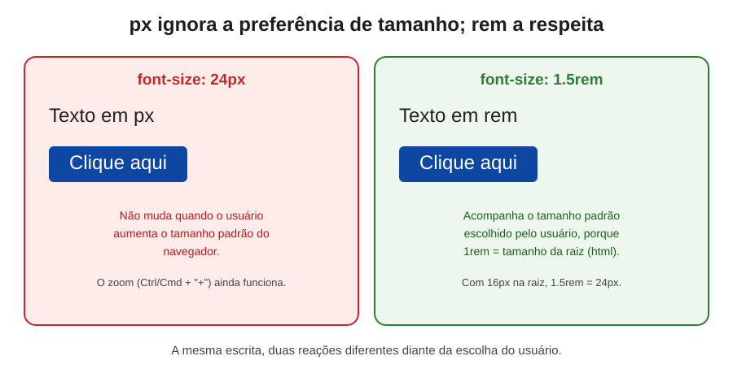
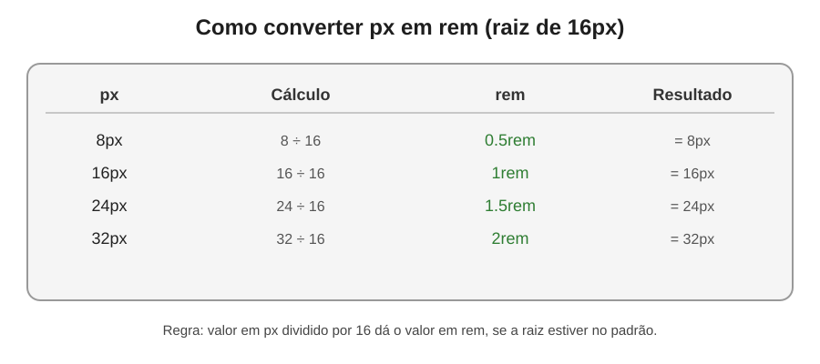

# Unidades no CSS: `px`, `rem` e `em`

> Uma documentação sobre como o CSS mede tamanhos, por que a escolha da unidade afeta quem precisa de texto maior e como `rem` e `em` se comportam de formas diferentes quando o tamanho muda.



---

## Índice

- [Introdução: o tamanho que cada pessoa precisa](#introdução-o-tamanho-que-cada-pessoa-precisa)
- [Parte 1: o que é uma unidade no CSS](#parte-1-o-que-é-uma-unidade-no-css)
- [Parte 2: `px`, a unidade fixa](#parte-2-px-a-unidade-fixa)
- [Parte 3: `rem`, a unidade relativa à raiz](#parte-3-rem-a-unidade-relativa-à-raiz)
  - [3.1 Convertendo px em rem](#31-convertendo-px-em-rem)
  - [3.2 Onde usar rem além de font-size](#32-onde-usar-rem-além-de-font-size)
- [Parte 4: a diferença que importa: preferência do usuário e zoom](#parte-4-a-diferença-que-importa-preferência-do-usuário-e-zoom)
  - [4.1 Zoom da página](#41-zoom-da-página)
  - [4.2 Tamanho de fonte padrão do navegador](#42-tamanho-de-fonte-padrão-do-navegador)
- [Parte 5: `em`, a unidade relativa ao pai](#parte-5-em-a-unidade-relativa-ao-pai)
  - [5.1 Como o `em` se acumula](#51-como-o-em-se-acumula)
  - [5.2 Por que a maioria prefere `rem`](#52-por-que-a-maioria-prefere-rem)
- [Parte 6: o que muda quando a raiz muda](#parte-6-o-que-muda-quando-a-raiz-muda)
- [Parte 7: comparação lado a lado](#parte-7-comparação-lado-a-lado)
- [Parte 8: erros comuns e como evitá-los](#parte-8-erros-comuns-e-como-evitá-los)
- [Parte 9: como testar você mesmo](#parte-9-como-testar-você-mesmo)
- [Glossário de termos técnicos](#glossário-de-termos-técnicos)
- [Referências e créditos](#referências-e-créditos)
- [Imagens desta documentação](#imagens-desta-documentação)

---

## Introdução: o tamanho que cada pessoa precisa

Um texto que parece perfeito na sua tela pode estar pequeno demais para outra pessoa. Quem tem baixa visão, quem está cansado, quem usa um monitor distante ou quem simplesmente prefere letras maiores precisa ajustar o tamanho para conseguir ler. A forma como o CSS mede os tamanhos decide se esse ajuste funciona ou não.

Esta documentação percorre as três unidades mais usadas para tamanhos de texto: `px`, `rem` e `em`. Para cada uma, explicamos o que é, como se comporta, quando usar e qual o impacto para quem precisa de um texto maior.

> **Uma nota de empatia:** quando um site ignora o tamanho escolhido pela pessoa, ela perde a autonomia sobre a própria leitura. Escolher a unidade certa é uma forma de dizer "o seu jeito de enxergar também é bem-vindo aqui".

---

## Parte 1: o que é uma unidade no CSS

Uma **unidade** é a medida usada para dar um valor a uma propriedade do CSS. Quando você escreve `font-size: 16px`, o `px` é a unidade, e o `16` é o valor.

Unidades se dividem em dois grupos principais:

- **Absolutas**: têm um tamanho fixo, independente de qualquer outro elemento. O `px` é a mais conhecida.
- **Relativas**: dependem de outro valor, como o tamanho da fonte da raiz ou do elemento pai. O `rem` e o `em` pertencem a esse grupo.

Essa diferença é a chave de toda a documentação. Uma unidade fixa não reage às mudanças do ambiente. Uma unidade relativa reage. E é justamente a reação às mudanças que permite respeitar a escolha de quem lê.

---

## Parte 2: `px`, a unidade fixa

O `px` (pixel) é uma unidade absoluta. Um `16px` vale 16 pixels no CSS, independentemente do tamanho que a pessoa escolheu para o texto padrão do navegador.

```css
p {
  font-size: 16px;
}
```

Essa unidade é simples e previsível, e por isso é tão usada. Ela funciona bem para bordas, sombras e outros detalhes que não precisam mudar com o tamanho do texto.

O problema aparece quando ela é usada para o tamanho do texto. Se a pessoa aumentar o tamanho de fonte padrão do navegador, um texto escrito em `px` **não acompanha** essa mudança. Ele continua do mesmo tamanho, como se a configuração não existisse.

Esse é o ponto central da seção de acessibilidade. Nada está quebrado no site, mas uma escolha legítima do usuário é ignorada.



---

## Parte 3: `rem`, a unidade relativa à raiz

O `rem` (*root em*) é uma unidade relativa ao **tamanho da fonte da raiz**. A raiz é o elemento `html`, o pai de todos os outros elementos da página.

Por padrão, na maioria dos navegadores, o tamanho da fonte da raiz é de **16 pixels**. Portanto, `1rem` equivale a 16px, `2rem` equivale a 32px e `1.5rem` equivale a 24px.

```css
p {
  font-size: 1.5rem; /* 1.5 x 16px = 24px, com a configuração padrão */
}
```

A grande vantagem é que o `rem` sempre se refere à raiz. Não importa quantos níveis de elementos existam entre o parágrafo e o `html`: o `rem` continua apontando para o mesmo valor base.

### 3.1 Convertendo px em rem

A conversão é simples: divida o valor em pixels pelo tamanho da raiz, que é 16 na maioria dos casos.

- `24px ÷ 16 = 1.5rem`
- `32px ÷ 16 = 2rem`
- `8px ÷ 16 = 0.5rem`


**Por que vale a pena converter?** Porque, mesmo que você pense em pixels, o `rem` permite que o texto cresça junto com a preferência da pessoa. Você continua pensando em pixels, mas escreve em `rem`. O navegador faz a conversão no momento da exibição, e esse valor pode mudar com a configuração do usuário.

Uma dúvida comum é se a conversão não fica mais complicada que o `px`. Na prática, depois de algumas repetições, a conta vira hábito, e muitos projetos definem uma tabela de referência para as medidas mais usadas.

### 3.2 Onde usar rem além de font-size

O `rem` não serve apenas para o tamanho do texto. Ele pode ser usado em qualquer propriedade que aceite unidade, como espaçamentos, larguras e alturas:

```css
.botao {
  font-size: 1.5rem;
  padding: 1rem 2rem; /* cima e baixo: 16px; lados: 32px, com a configuração padrão */
}
```

Quando o texto aumenta, o padding acompanha, e o botão continua proporcional ao seu conteúdo. Isso evita o problema de um texto grande dentro de uma caixa pequena demais.

---

## Parte 4: a diferença que importa: preferência do usuário e zoom

Esta é a parte que mais influencia a acessibilidade. Antes de explicar, vale separar dois comportamentos que costumam ser confundidos: o **zoom da página** e o **tamanho de fonte padrão**.

### 4.1 Zoom da página

O zoom aumenta tudo na tela, incluindo imagens, botões, espaçamentos e textos em `px`. Ele é feito com Ctrl + "+" no Windows ou Cmd + "+" no Mac, e geralmente é a forma mais rápida de ampliar um site.

Por isso, tanto `px` quanto `rem` respondem ao zoom da mesma forma. Se a pessoa aumenta a página, os dois tipos de texto crescem juntos.

### 4.2 Tamanho de fonte padrão do navegador

Os navegadores também oferecem uma configuração para o tamanho de fonte padrão, geralmente em Configurações, na seção de aparência. Quando a pessoa escolhe um tamanho maior, esse valor passa a ser o tamanho base da raiz.

- O texto em `rem` cresce, porque se baseia na raiz.
- O texto em `px` não cresce, porque tem um valor fixo.

Esse é um dos pontos mais importantes desta documentação. Quando o texto em `px` não responde à configuração, a pessoa perde a possibilidade de ampliar a leitura por esse caminho. E é isso que torna o `px` uma escolha que exige cuidado, em especial para o tamanho do texto.

**Vale notar:** o zoom ainda é o caminho mais comum, porque é mais fácil de encontrar. Mas nem toda pessoa usa o zoom, e nem toda configuração de navegador é a mesma. Por isso, respeitar as duas formas é a atitude mais inclusiva.

**Uma referência importante:** os critérios de acessibilidade da W3C pedem que o texto possa ser ampliado até 200% sem perder conteúdo ou funcionalidade. Ajustar o tamanho do texto com `rem` ajuda a cumprir esse objetivo de forma mais natural.

---

## Parte 5: `em`, a unidade relativa ao pai

O `em` também é uma unidade relativa, mas com uma referência diferente: ela se baseia no **tamanho da fonte do elemento pai**, e não da raiz.

```css
div {
  font-size: 2rem; /* 32px, com a configuração padrão */
}

p {
  font-size: 2em; /* 2 x 32px = 64px, porque o pai da p tem 32px */
}
```

Repare que o `em` na `p` olha para o tamanho da `div`, e não para o `html`. Essa é a diferença central entre as duas unidades.

Há uma regra adicional que vale saber:

- Quando o `em` está na propriedade `font-size`, ele se refere ao tamanho da fonte do **pai**.
- Quando o `em` está em outras propriedades, como `padding` ou `margin`, ele se refere ao tamanho da fonte do **próprio elemento**.

Isso pode gerar confusão, e é uma das razões pelas quais o `em` é menos previsível que o `rem`.

### 5.1 Como o `em` se acumula

Como cada nível de elementos pode mudar o tamanho da fonte, o `em` se multiplica quando os elementos estão aninhados. Veja um exemplo com valores fictícios para facilitar a compreensão:

```html
<div class="externo">
  <div class="interno">
    <p class="texto">Parágrafo</p>
  </div>
</div>
```

```css
.externo  { font-size: 200%; } /* 2 x 16px = 32px */
.interno  { font-size: 200%; } /* 2 x 32px = 64px */
.texto    { font-size: 2em; }  /* 2 x 64px = 128px */
```

O tamanho cresce a cada nível, e isso dificulta prever o resultado. Com `rem`, o `.texto` teria `2rem`, ou seja, 32px, sem importar quantos níveis existem.

Quando a estrutura muda, um `em` que funcionava pode ficar gigante ou pequeno demais, sem que a pessoa que escreveu o CSS perceba de imediato. Essa imprevisibilidade é o principal motivo para preferir `rem` em tamanhos de texto.


### 5.2 Por que a maioria prefere rem

O `em` continua válido e tem seu lugar, por exemplo para espaçamentos que devem acompanhar o próprio texto de um componente, como um botão cujo padding cresce junto com a fonte dele. Mas, para tamanhos gerais, o `rem` é mais previsível.

A recomendação prática é simples: use `rem` para tamanhos de texto e espaçamentos gerais, e reserve o `em` para casos em que o tamanho deve depender do próprio componente.

---

## Parte 6: o que muda quando a raiz muda

Quando o tamanho da raiz muda, as unidades relativas à raiz acompanham a mudança. Veja o comportamento em uma situação prática:

- Com a raiz em 16px, `1rem` vale 16px.
- Se a raiz passar para 32px, `1rem` passa a valer 32px.
- O `px` continua valendo o mesmo, porque não depende da raiz.

Isso mostra por que o `px` não responde à preferência do usuário. Ele não lê a raiz, e por isso não muda quando ela muda.

Vale lembrar uma coisa: a raiz é controlada pelo navegador e pelo usuário. O seu CSS pode definir um valor diferente para o `html`, mas essa escolha deve ser feita com cuidado, porque ela afeta todo o site.

---

## Parte 7: comparação lado a lado

| Situação | Com `px` | Com `rem` | Com `em` |
|---|---|---|---|
| Zoom da página | Cresce | Cresce | Cresce |
| Tamanho de fonte padrão do navegador | Não muda | Cresce | Cresce, mas depende do pai |
| Referência | Valor fixo | Raiz (`html`) | Pai (em `font-size`) ou próprio elemento |
| Previsibilidade | Alta | Alta | Baixa em estruturas aninhadas |
| Respeito à preferência do usuário | Limitado | Alto | Alto, mas com cuidado |
| Recomendado para tamanho de texto | Não | Sim | Em casos específicos |

---

## Parte 8: erros comuns e como evitá-los

### Erro 1: usar `px` para todo o texto

**O que acontece:** a pessoa que aumentou a fonte padrão não vê a mudança no texto.

**Como corrigir:** use `rem` para tamanhos de texto. O `px` pode continuar em bordas e detalhes.

### Erro 2: usar `em` em toda a página sem pensar no aninhamento

**O que acontece:** o tamanho cresce a cada nível, e o texto fica gigante ou pequeno demais em partes da página.

**Como corrigir:** prefira `rem`, que sempre se refere à raiz.

### Erro 3: confundir zoom com preferência de fonte

**O que acontece:** a pessoa acha que o site está acessível porque o zoom funciona, mas não percebe que o tamanho padrão é ignorado.

**Como corrigir:** teste as duas formas: zoom e alteração do tamanho de fonte padrão nas configurações do navegador.

### Erro 4: esquecer que o `rem` depende da raiz

**O que acontece:** alguém define um tamanho diferente no `html` e surpreende-se com o resultado em todo o site.

**Como corrigir:** defina o tamanho da raiz com cuidado e documente essa escolha, porque ela afeta toda a página.

### Erro 5: aplicar `em` em `font-size` achando que é sobre o próprio elemento

**O que acontece:** o `em` se refere ao pai, e o resultado não é o esperado.

**Como corrigir:** lembre-se de que, em `font-size`, o `em` é relativo ao pai. Se a intenção for outra, use `rem`.

### Erro 6: texto em `px` dentro de um botão ou caixa fixa

**O que acontece:** o texto cresce quando a configuração muda, mas a caixa com altura em `px` não acompanha, e o texto transborda.

**Como corrigir:** use `rem` também na altura e no padding, para que a caixa cresça junto com o conteúdo.

---

## Parte 9: como testar você mesmo

### Teste de zoom

No navegador, aumente o zoom com Ctrl + "+" (Windows) ou Cmd + "+" (Mac). Observe se o texto e os componentes crescem juntos, sem cortes ou sobreposições.

### Teste de tamanho de fonte padrão

Nas configurações do navegador, na seção de aparência, aumente o tamanho de fonte padrão para um valor maior. Volte à página e veja se os textos em `rem` acompanharam a mudança, e se os textos em `px` continuam iguais.

### Teste com o inspetor

Clique com o botão direito em um texto e escolha **Inspecionar**. Na aba de estilos, confira a unidade usada e o valor calculado. O navegador mostra o valor final em pixels, o que ajuda a entender a conversão.

### Teste de largura

Aumente o tamanho do texto e reduza a largura da janela. Observe se o conteúdo se reorganiza sem perder informação. Esse teste está ligado ao critério de reflow da W3C, que trata da adaptação do conteúdo a telas estreitas e ampliações.

---

## Glossário de termos técnicos

**Absoluta (unidade):** unidade de tamanho fixo, que não depende de outros valores. O `px` é a principal.

**`em`:** unidade relativa ao tamanho da fonte do elemento pai, quando usada em `font-size`, ou ao próprio elemento, quando usada em outras propriedades.

**Herança:** mecanismo pelo qual um elemento recebe características do seu pai. Em unidades relativas, o pai influencia o valor calculado.

**Raiz (root):** o elemento `html`, pai de todos os outros elementos da página. Seu tamanho de fonte serve de base para o `rem`.

**`px` (pixel):** unidade absoluta que representa um ponto fixo na tela, usada para valores que não devem mudar com o tamanho do texto.

**Relativa (unidade):** unidade cujo valor depende de outro valor, como o tamanho da raiz ou do elemento pai.

**`rem` (root em):** unidade relativa ao tamanho da fonte da raiz. Com a configuração padrão, `1rem` equivale a 16px.

**Reflow:** adaptação do conteúdo quando a largura da tela diminui ou quando o texto é ampliado, sem perda de informação nem necessidade de rolagem horizontal.

**Zoom:** ampliação de toda a página, incluindo imagens, botões e textos, feita pelo navegador.

---

## Referências e créditos

As informações desta documentação foram parafraseadas a partir das fontes abaixo. Sempre que possível, consulte o original para aprofundamento.

### Documentações oficiais

- **MDN Web Docs – Valores e unidades do CSS**, guia da Mozilla sobre as unidades de medida do CSS. Disponível em: https://developer.mozilla.org/pt-BR/docs/Learn/CSS/Building_blocks/Values_and_units

- **MDN Web Docs – Tipo de dado `length`**, sobre as unidades de comprimento, incluindo `px`, `em` e `rem`. Disponível em: https://developer.mozilla.org/pt-BR/docs/Web/CSS/length

- **W3C – CSS Values and Units Module Level 4**, especificação oficial do CSS que define as unidades de medida, incluindo as relativas à raiz e ao elemento. Disponível em: https://www.w3.org/TR/css-values-4/

- **W3C WAI – Understanding WCAG 2.2, critério 1.4.4 (Redimensionar o texto)**, explica a exigência de que o texto possa ser ampliado até 200% sem perda de conteúdo ou funcionalidade. Disponível em: https://www.w3.org/WAI/WCAG22/Understanding/resize-text.html

- **W3C WAI – Understanding WCAG 2.2, critério 1.4.10 (Reflow)**, sobre a adaptação do conteúdo a telas estreitas e a ampliações. Disponível em: https://www.w3.org/WAI/WCAG22/Understanding/reflow.html

- **web.dev – Learn Accessibility**, curso gratuito do Google sobre acessibilidade, com conteúdo sobre tamanho de texto e zoom. Disponível em: https://web.dev/learn/accessibility

---

## Imagens desta documentação

As imagens estão na pasta `./src/assets/images/` e podem ser baixadas separadamente:

1. `./src/assets/images/px-vs-rem-preferencia.svg`: comparação entre `px` e `rem` diante da preferência de tamanho do usuário.
2. `./src/assets/images/em-vs-rem-heranca.svg`: como o `em` se acumula em relação ao `rem`.
3. `./src/assets/images/conversao-px-rem.svg`: tabela de conversão de `px` para `rem`, com raiz de 16px.

---

**Para concluir:** a unidade é uma escolha pequena, mas que diz muito sobre quem está do outro lado da tela. Quando o texto responde ao tamanho escolhido pela pessoa, o site deixa de ser uma barreira e passa a ser um espaço que se adapta a ela. Escrever em `rem` é uma forma simples de respeitar a leitura de todos.