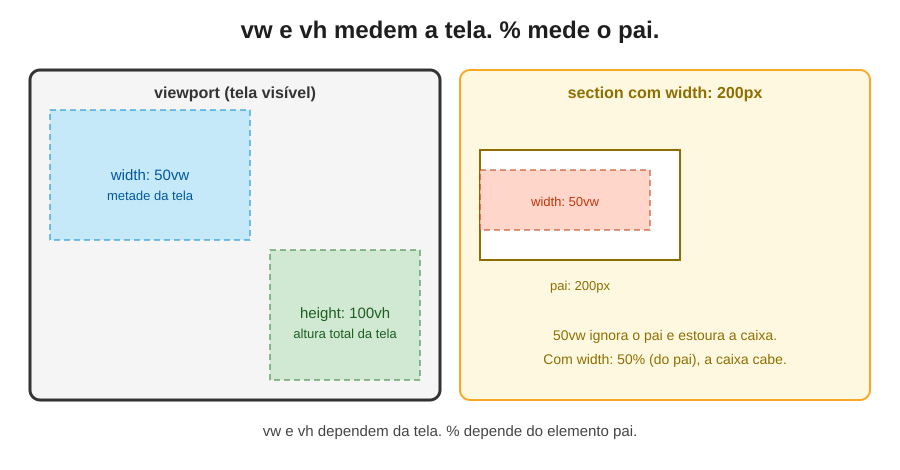
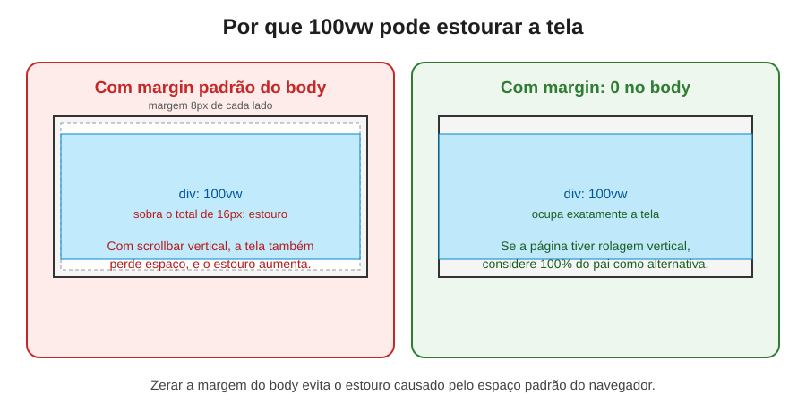
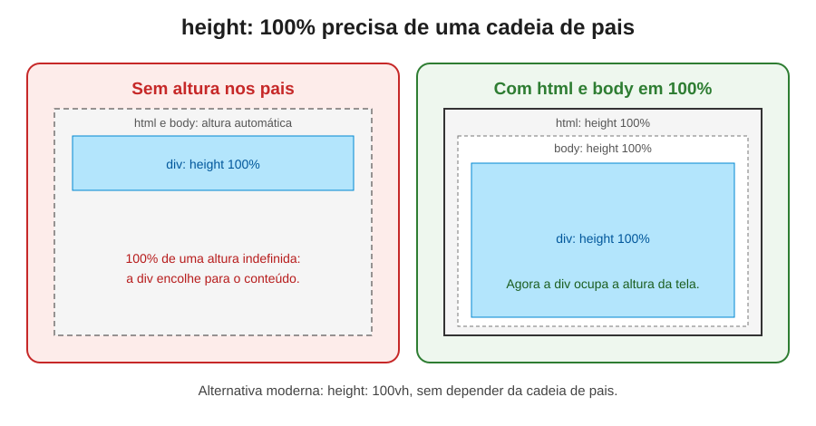

# Unidades de viewport e a função `calc()`: `vw`, `vh`, porcentagem e cálculos no CSS

> Uma documentação sobre como medir o tamanho da tela visível, por que `vw` e `vh` não são o mesmo que porcentagem, como resolver a altura de 100% da tela e como combinar unidades diferentes com `calc()`.



---

## Índice

- [Introdução: a tela que cada pessoa vê](#introdução-a-tela-que-cada-pessoa-vê)
- [Parte 1: o que é o viewport](#parte-1-o-que-é-o-viewport)
- [Parte 2: `vw` e `vh`, as unidades de viewport](#parte-2-vw-e-vh-as-unidades-de-viewport)
- [Parte 3: vw e vh não são porcentagem](#parte-3-vw-e-vh-não-são-porcentagem)
- [Parte 4: por que `100vw` pode estourar a tela](#parte-4-por-que-100vw-pode-estourar-a-tela)
- [Parte 5: ocupar 100% da altura da tela](#parte-5-ocupar-100-da-altura-da-tela)
  - [5.1 O método antigo: a cadeia de altura](#51-o-método-antigo-a-cadeia-de-altura)
  - [5.2 O método atual: `100vh`](#52-o-método-atual-100vh)
  - [5.3 O cuidado com celulares](#53-o-cuidado-com-celulares)
- [Parte 6: a função `calc()`](#parte-6-a-função-calc)
  - [6.1 Calculando frações da tela](#61-calculando-frações-da-tela)
  - [6.2 Misturando unidades](#62-misturando-unidades)
  - [6.3 Ela pesa no desempenho?](#63-ela-pesa-no-desempenho)
- [Parte 7: comparação lado a lado](#parte-7-comparação-lado-a-lado)
- [Parte 8: erros comuns e como evitá-los](#parte-8-erros-comuns-e-como-evitá-los)
- [Parte 9: como testar você mesmo](#parte-9-como-testar-você-mesmo)
- [Glossário de termos técnicos](#glossário-de-termos-técnicos)
- [Referências e créditos](#referências-e-créditos)
- [Imagens desta documentação](#imagens-desta-documentação)

---

## Introdução: a tela que cada pessoa vê

Cada pessoa usa a web em um tamanho diferente: um notebook, um monitor grande, um celular na vertical, uma janela de navegador ocupando só metade da tela. O mesmo site precisa caber em todos esses cenários sem perder conteúdo nem se desmontar.

Para isso, o CSS oferece formas de medir o espaço disponível na tela, e não apenas o espaço dentro de outro elemento. Esta documentação explica essas medidas, mostra os erros mais comuns de quem está começando e apresenta a função `calc()`, que permite fazer contas diretamente no CSS.

> **Uma nota de empatia:** um layout que estoura a tela, cria uma barra de rolagem lateral inesperada ou corta um botão afeta principalmente quem usa zoom alto, leitores de tela com ampliação ou aparelhos menores. Entender a medida certa é uma forma de deixar o conteúdo acessível para todos esses cenários.

---

## Parte 1: o que é o viewport

O **viewport** (ou janela de visualização) é a área visível da página no navegador. Não é a tela inteira do computador, nem o tamanho do documento: é o pedaço da página que está aparecendo neste momento para quem olha.

Quando você redimensiona a janela, o viewport muda. Quando você rola a página, o viewport continua do mesmo tamanho, mas mostra outra parte do conteúdo.

Essa distinção é importante porque o CSS tem unidades que medem o viewport diretamente, e outras que medem elementos específicos. Confundir as duas é a origem de boa parte dos problemas de layout.

---

## Parte 2: `vw` e `vh`, as unidades de viewport

As unidades de viewport são relativas ao tamanho da janela visível:

- **`vw`** (*viewport width*): 1% da largura visível da tela.
- **`vh`** (*viewport height*): 1% da altura visível da tela.

Assim, `100vw` ocupa toda a largura da janela, e `100vh` ocupa toda a altura.

```css
.tela-cheia {
  width: 100vw;
  height: 100vh;
}

.metade-da-largura {
  width: 50vw; /* metade da largura visível da tela */
}
```

Essas unidades são absolutas em relação à janela, o que significa que mudam sempre que a janela muda de tamanho. Não importa onde o elemento esteja na página: o valor sempre se refere à tela visível.

---

## Parte 3: vw e vh não são porcentagem

Este é um dos erros mais frequentes de quem está começando. Muita gente acredita que `100vw` é a mesma coisa que `100%`. Não é.

- **Porcentagem (`%`)** é relativa ao **elemento pai**. Se o pai tem 200px de largura, `50%` vale 100px.
- **Unidade de viewport (`vw`, `vh`)** é relativa à **tela visível**. Se a tela tem 1000px de largura, `50vw` vale 500px, mesmo que o pai tenha só 200px.


Um exemplo que mostra a diferença: imagine uma seção com largura de 200px, e dentro dela uma caixa com `width: 50vw`. Em uma tela de 1000px, a caixa terá 500px, maior que a seção. Ela vai estourar o espaço do pai.

Se, no lugar disso, a caixa tivesse `width: 50%`, ela valeria 100px, metade da seção. Cabe no pai.

**Regra prática:** use porcentagem quando quiser que um elemento se encaixe no espaço do pai. Use `vw` ou `vh` quando quiser que ele se relacione com a tela inteira.

---

## Parte 4: por que `100vw` pode estourar a tela

Quando você define um elemento com `width: 100vw`, ele tenta ocupar toda a largura da janela. Em muitos casos, isso funciona. Mas há duas causas comuns para o estouro, que aparece como uma barra de rolagem horizontal.

### Causa 1: a margem padrão do body

Os navegadores aplicam ao `body` uma margem padrão, geralmente de 8px de cada lado. Se um elemento ocupa 100% da largura da tela e ainda existe a margem do `body`, o total ultrapassa a janela.

```css
/* Sem essa correção, a div pode estourar a tela */
body {
  margin: 0;
}

.tela {
  width: 100vw;
}
```

Ao zerar a margem do `body`, o elemento passa a ocupar exatamente a largura da janela, sem sobras.



### Causa 2: a barra de rolagem vertical

Quando a página tem rolagem vertical, a barra lateral ocupa espaço na tela. A unidade `100vw` inclui essa largura, porque mede a janela inteira. Por isso, mesmo com a margem zerada, um elemento de `100vw` pode gerar uma pequena rolagem horizontal.

A solução mais segura, nesses casos, é usar `width: 100%` no elemento que deve ocupar a largura do pai, quando esse pai já ocupa a tela corretamente. Assim, a barra de rolagem é considerada automaticamente pelo layout.

**Resumo:** `100vw` é útil para medir a tela, mas pode incluir espaços que o layout não considera. Teste o resultado em uma página com rolagem vertical antes de confiar nele.

---

## Parte 5: ocupar 100% da altura da tela

Ocupar a altura total da tela é uma necessidade comum, por exemplo em uma capa de site, em um painel ou em uma tela de login. Há dois caminhos, um antigo e um atual.

### 5.1 O método antigo: a cadeia de altura

Na porcentagem, a altura de 100% depende da altura do pai. Se o pai não tem altura definida, a porcentagem não tem uma referência, e o elemento se ajusta ao próprio conteúdo.

Por isso, o método antigo exigia definir a altura em toda a cadeia de elementos, do `html` até o elemento desejado:

```css
html,
body {
  height: 100%;
  margin: 0;
}

.capa {
  height: 100%; /* agora tem um pai com altura definida */
}
```

Com `html` e `body` em 100%, a cadeia está completa, e a div ocupa a altura da tela.



Esse método funciona, mas exige um cuidado constante: se um elemento intermediário não tiver altura definida, a cadeia quebra e o resultado não é o esperado.

### 5.2 O método atual: `100vh`

Com a unidade de viewport, esse problema desaparece. Basta definir a altura como `100vh`, e o elemento ocupa a altura visível da tela, sem depender dos pais:

```css
.capa {
  height: 100vh;
}
```

Em muitos casos, o mais seguro é usar `min-height` em vez de `height`. Assim, o elemento ocupa pelo menos a tela inteira, mas pode crescer se o conteúdo for maior:

```css
.capa {
  min-height: 100vh;
}
```

### 5.3 O cuidado com celulares

Em celulares, a altura visível muda quando a barra de endereço do navegador aparece ou desaparece. Um `100vh` pode ficar maior que a área realmente visível, e a parte de baixo do conteúdo pode ficar escondida atrás da barra.

Para lidar com isso, o CSS moderno oferece variações da unidade `vh`, que levam em conta esse comportamento:

- **`svh`** (*small viewport height*): altura com a barra do navegador visível, o menor valor possível;
- **`lvh`** (*large viewport height*): altura com a barra escondida, o maior valor possível;
- **`dvh`** (*dynamic viewport height*): altura que acompanha a barra quando ela aparece ou some.

```css
.capa {
  min-height: 100vh;   /* valor de apoio para navegadores antigos */
  min-height: 100dvh;  /* acompanha a barra do navegador em celulares */
}
```

A ordem importa: o navegador usa o último valor que consegue entender. Por isso, o valor com `vh` vem primeiro, como apoio, e o `dvh` vem depois. Esses valores são recentes, então confira a compatibilidade no seu público antes de depender apenas deles.

---

## Parte 6: a função `calc()`

Até aqui, os valores eram números com uma unidade. A função `calc()` permite escrever uma **conta** diretamente no valor de uma propriedade. Ela aceita as quatro operações básicas (soma, subtração, multiplicação e divisão) e pode misturar unidades diferentes.

```css
.caixa {
  width: calc(100vw / 3); /* um terço da largura da tela */
}
```

A função é um recurso do próprio CSS. Quando o navegador encontra a conta, ele calcula o resultado e aplica o valor final.

### 6.1 Calculando frações da tela

Você pode dividir a tela em partes iguais de forma direta:

```css
.coluna {
  width: calc(100vw / 3);   /* um terço da tela */
}

.coluna-menor {
  width: calc(100vw / 16);  /* um dezesseis avos da tela */
}
```

Essa abordagem é prática, porque você não precisa calcular o valor fora do CSS. Se quiser mudar a divisão, basta alterar o número. Em termos de resultado, o mesmo valor poderia ser escrito como uma porcentagem ou um número fixo, mas a conta deixa claro a intenção.

### 6.2 Misturando unidades

A vantagem mais importante do `calc()` é combinar unidades diferentes. Imagine uma barra lateral que sempre precisa ter 100 pixels a menos do que a largura da tela, independentemente do tamanho da janela:

```css
.conteudo {
  width: calc(100vw - 100px);
}
```

Em uma tela de 1000px, o conteúdo terá 900px. Em uma tela de 500px, terá 400px. A subtração sempre remove exatamente 100 pixels, e isso é impossível de fazer com uma única unidade.

Esse recurso é especialmente útil quando há um elemento de tamanho fixo na tela, como uma barra lateral ou um cabeçalho, e o restante do layout precisa ocupar o espaço sobrando.

**Dica de sintaxe:** no `calc()`, os sinais de soma e subtração precisam ter espaço ao redor, como em `100vw - 100px`. Sem os espaços, o CSS pode não reconhecer a conta.

### 6.3 Ela pesa no desempenho?

É comum ouvir que cálculos no CSS deixam o site lento. Na prática, o navegador calcula valores de tamanho o tempo todo, inclusive quando você usa `100vh` ou porcentagem. Um `calc()` simples não tem impacto perceptível no desempenho da página.

Vale apenas evitar cálculos desnecessários, como uma conta que sempre resulta no mesmo número. Nesse caso, escrever o valor pronto é mais simples de ler.

---

## Parte 7: comparação lado a lado

| Recurso | O que mede | Exemplo | Quando usar |
|---|---|---|---|
| `%` | Tamanho do elemento pai | `width: 50%` | Encaixar dentro do espaço do pai |
| `vw` | Largura da janela visível | `width: 50vw` | Relacionar com a largura da tela |
| `vh` | Altura da janela visível | `height: 100vh` | Ocupar a altura da tela |
| `dvh` | Altura da janela, com a barra do navegador | `min-height: 100dvh` | Telas de celular com barra que aparece e some |
| `calc()` | Uma conta entre valores | `width: calc(100vw - 100px)` | Misturar unidades ou dividir a tela |

---

## Parte 8: erros comuns e como evitá-los

### Erro 1: achar que `vw` é o mesmo que `%`

**O que acontece:** o elemento estoura o pai, porque `50vw` ignora o tamanho do pai.

**Como corrigir:** use `%` quando o elemento deve caber no pai, e `vw` quando deve se relacionar com a tela.

### Erro 2: `100vw` sem zerar a margem do body

**O que acontece:** aparece uma barra de rolagem horizontal, porque a margem padrão soma ao total.

**Como corrigir:** defina `margin: 0` no `body`, ou use `width: 100%` quando o pai já ocupa a tela.

### Erro 3: `height: 100%` sem pais com altura definida

**O que acontece:** a altura não muda, porque a porcentagem não tem referência.

**Como corrigir:** use `100vh` para ocupar a tela, ou defina a altura do `html` e do `body` antes.

### Erro 4: `100vh` em celulares cortando o conteúdo

**O que acontece:** a parte inferior do conteúdo fica atrás da barra do navegador.

**Como corrigir:** use `min-height` com `dvh` depois do `vh`, como mostrado na Parte 5.3.

### Erro 5: `calc()` sem espaço ao redor do sinal

**O que acontece:** a conta é ignorada, e a propriedade não recebe o valor esperado.

```css
/* Errado: sem espaço ao redor do sinal de menos */
width: calc(100vw-100px);

/* Certo: com espaço */
width: calc(100vw - 100px);
```

**Como corrigir:** escreva sempre espaços antes e depois de `+` e `-` dentro do `calc()`.

### Erro 6: usar `calc()` para contas que sempre dão o mesmo número

**O que acontece:** o código fica mais difícil de ler, sem nenhum ganho.

**Como corrigir:** use `calc()` quando a conta misturar unidades ou quando o valor precisar mudar com a tela. Para valores fixos, escreva o número pronto.

---

## Parte 9: como testar você mesmo

### Teste de estouro

Abra a página em uma janela estreita e em uma larga. Observe se aparece uma barra de rolagem horizontal. Se aparecer, revise elementos com `100vw` e margens do `body`.

### Teste de altura

Use o inspetor do navegador e confira a altura calculada do elemento. Verifique se ela corresponde à altura da janela, e não ao conteúdo.

### Teste de zoom

Aumente o zoom da página com Ctrl + "+" (Windows) ou Cmd + "+" (Mac). Veja se os elementos com `100vh` e `100vw` continuam encaixados, e se o conteúdo não fica escondido ou cortado.

### Teste em celular

Use o modo de dispositivo do inspetor, ou um celular real, e role a página. Observe se a parte de baixo do conteúdo fica escondida atrás da barra do navegador, principalmente em elementos com `100vh`.

---

## Glossário de termos técnicos

**`calc()`:** função do CSS que calcula um valor a partir de uma expressão com operações básicas e unidades.

**`dvh` (*dynamic viewport height*):** altura da janela que acompanha a barra do navegador quando ela aparece ou some.

**`lvh` (*large viewport height*):** altura da janela com a barra do navegador escondida.

**`min-height`:** propriedade que define a altura mínima de um elemento, que pode crescer conforme o conteúdo.

**Porcentagem (`%`):** unidade relativa ao tamanho do elemento pai.

**Margem padrão do body:** espaço que o navegador aplica por padrão ao `body`, geralmente de 8px.

**Estouro (overflow):** situação em que o conteúdo ultrapassa os limites do elemento ou da tela, podendo gerar barras de rolagem.

**Viewport (janela de visualização):** área visível da página no navegador, no momento em que a pessoa a vê.

**`vh` (*viewport height*):** unidade que representa 1% da altura visível da janela.

**`vw` (*viewport width*):** unidade que representa 1% da largura visível da janela.

**`svh` (*small viewport height*):** altura da janela com a barra do navegador visível, o menor valor possível.

---

## Referências e créditos

As informações desta documentação foram parafraseadas a partir das fontes abaixo. Sempre que possível, consulte o original para aprofundamento.

### Documentações oficiais

- **MDN Web Docs – Tipo de dado `length`**, sobre as unidades de comprimento, incluindo `vw`, `vh`, `dvh`, `lvh` e `svh`. Disponível em: https://developer.mozilla.org/pt-BR/docs/Web/CSS/length

- **MDN Web Docs – Função `calc()`**, sobre as operações e o uso de unidades mistas. Disponível em: https://developer.mozilla.org/pt-BR/docs/Web/CSS/calc

- **MDN Web Docs – Valores e unidades do CSS**, guia sobre as unidades de medida do CSS. Disponível em: https://developer.mozilla.org/pt-BR/docs/Learn/CSS/Building_blocks/Values_and_units

- **W3C – CSS Values and Units Module Level 4**, especificação oficial que define as unidades de viewport, a função `calc()` e as variações dinâmicas de altura. Disponível em: https://www.w3.org/TR/css-values-4/

- **W3C WAI – Understanding WCAG 2.2, critério 1.4.10 (Reflow)**, sobre a adaptação do conteúdo a telas estreitas e a ampliações, que se relaciona ao uso de larguras fixas com unidades de viewport. Disponível em: https://www.w3.org/WAI/WCAG22/Understanding/reflow.html

- **W3C WAI – Understanding WCAG 2.2, critério 1.4.4 (Redimensionar o texto)**, sobre a ampliação do texto até 200%. Disponível em: https://www.w3.org/WAI/WCAG22/Understanding/resize-text.html

---

## Imagens desta documentação

As imagens estão na pasta `src/assets/images/` e podem ser baixadas separadamente:

1. `src/assets/images/vw-vh-viewport.svg`: diferença entre medidas da tela (`vw`, `vh`) e medidas do pai (`%`).
2. `src/assets/images/overflow-body-margin.svg`: por que `100vw` pode estourar a tela com a margem padrão do `body`.
3. `src/assets/images/cadeia-altura-100.svg`: a cadeia de altura necessária para `height: 100%`.

---

**Para concluir:** medir a tela certa é uma parte essencial de um layout que funciona em qualquer aparelho. Entender quando usar a tela, quando usar o pai e quando fazer uma conta direto no CSS evita estouros, cortes e surpresas. Um layout que se adapta à janela de quem está do outro lado é um layout que respeita a forma como cada pessoa usa a web.